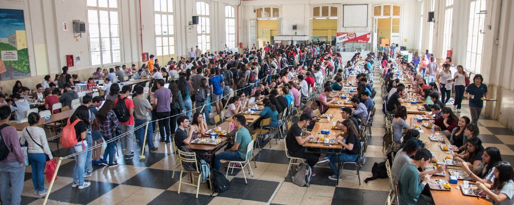
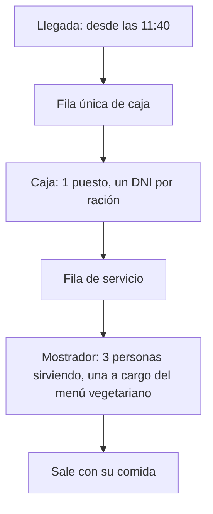
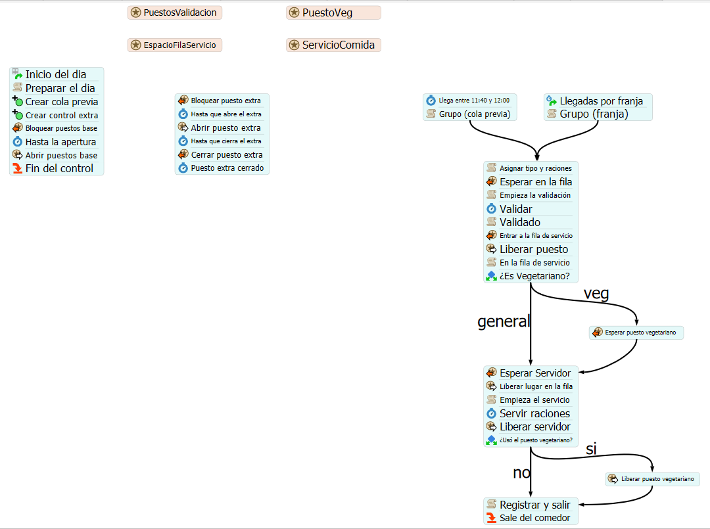
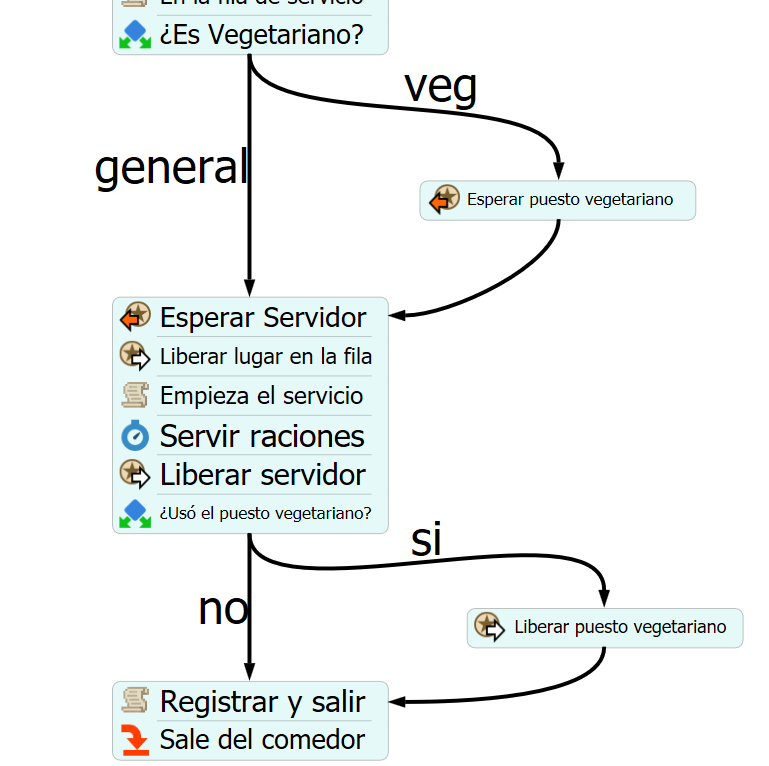
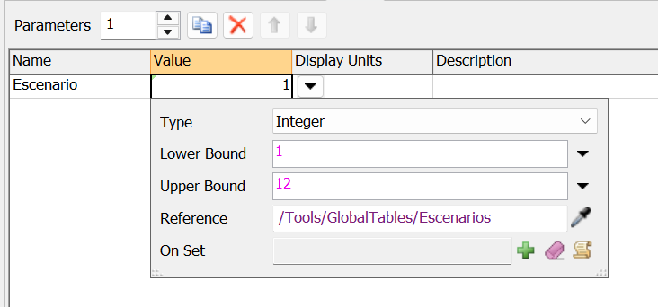
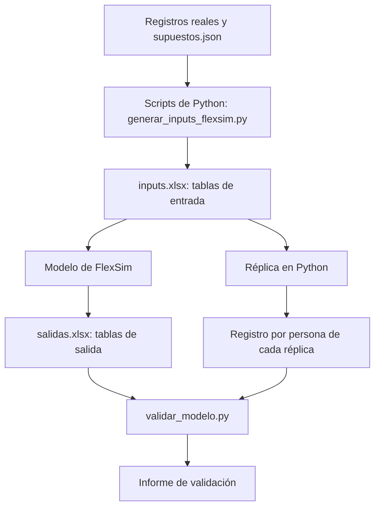
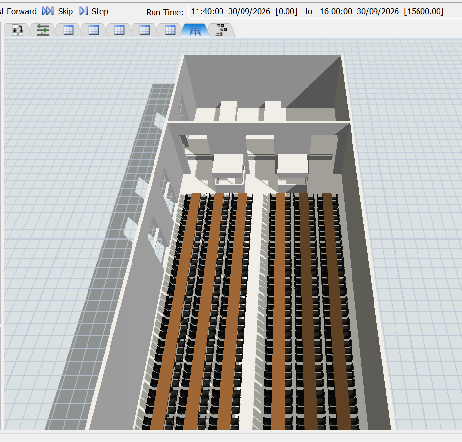

# TPI Simulación: Comedor Universitario UNC, avance al 14/10

[TOC]

**Integrantes:** Jonatan Harbertz y Juan Chavez · **Software:** FlexSim 2026 for Education, con Process Flow

Este documento resume para la cátedra el estado del trabajo desde la Entrega 1: qué cambió del planteo y por qué, de dónde salen los datos, cómo está armado el modelo, cómo se conectan las tablas de entrada, las de salida y la réplica en Python, cómo lo validamos, qué muestran los primeros resultados y qué queremos consultar.

## Resumen

- **Conseguimos los registros reales del comedor:** 34.509 retiros en 32 días de servicio. Con ellos calculamos las llegadas por franja y el tiempo de validación, que en la Entrega 1 eran supuestos.
- **Cambió el alcance**, siguiendo la devolución de la cátedra. Ahora el sistema va desde la llegada a la fila hasta retirar la comida en el mostrador. Así se puede ver si mejorar la caja solo corre la cola al servicio de comida.
- **El modelo de FlexSim corre de punta a punta** en el escenario base y coincide con lo real: cola máxima de 73 personas en la caja (se observan 60 a 70), 1.531 raciones validadas en el día (se observan 1.546) y casi nada de cola en el mostrador (5 personas, como en el comedor).
- **El modelo se alimenta de tablas de Excel y exporta tablas de Excel**, y tiene una réplica independiente en Python que usa las mismas tablas. Se verifican entre sí: si dan distinto, hay un error de armado en uno de los dos.
- **Con el servicio de 5 a 15 s por ración que midió un integrante del grupo, el mostrador no es el cuello de botella.** La caja sí lo es durante los primeros 90 minutos, pero agregar un puesto o validar con QR solo baja la espera máxima desde la apertura de 5 a 2 o 3 minutos. De los 14 minutos que espera quien llega antes de abrir, unos 12 son esperar a que abran.
- **El supuesto más débil es el tiempo de servicio por ración (S15).** Si fuera mayor a unos 13 s, el mostrador pasaría a ser el cuello de botella y las conclusiones cambiarían. Por eso hacemos un análisis de sensibilidad.

## 1. El sistema y la pregunta

El Comedor Universitario de la UNC funciona con reserva previa online. Al mediodía, quien reservó hace la fila, valida su reserva con el DNI en el puesto de control (la caja), pasa al mostrador y retira su comida. En el pico se forma una fila de 60 a 70 personas que serpentea entre las mesas.



*Figura 1. El salón en el horario de almuerzo. A la izquierda, la fila avanza entre las mesas, guiada con cordones.*

### Pregunta de estudio

> ¿Qué combinación de puestos de validación, organización de la fila y personas en el servicio de comida reduce el tiempo total desde la llegada hasta retirar la comida en el pico, sin que mejorar la caja solo traslade la cola al mostrador?

### Alcance



**Quedan fuera:** la reserva online, la cocina (su capacidad supera la demanda, S20), el salón y el retiro para llevar. Lo que la persona hace después de retirar la comida no cambia las filas que estudiamos.

## 2. Qué cambió desde la Entrega 1

| Tema | Entrega 1 | Ahora | Por qué |
|---|---|---|---|
| Pregunta | Cuántos puestos y qué horario límite de reserva | Puestos, organización de la fila y personas sirviendo | En los datos, la hora de reserva casi no predice la hora de llegada (correlación 0,13). El horario límite sirve para planificar la cocina, no cambia la cola (D04) |
| Alcance | De la reserva online a la validación | De la llegada a la fila hasta el mostrador | Devolución de la cátedra: si se mejora la caja, la cola puede pasar al mostrador (D02) |
| Fuente de datos | Registros pendientes de acceso | Export real del sistema de reservas | Lo conseguimos: 34.509 retiros del 1/7 al 1/9 |
| Tiempo de validación | Exponencial, 12 a 18 s por persona | Lognormal, media 3,8 s por DNI | Con 12 a 18 s, un puesto no puede validar 168 reservas en 10 minutos, como se ve en los registros (S07) |
| Mostrador | Línea vegetariana y no vegetariana, sin tiempos | 3 personas, una a cargo del menú vegetariano, 5 a 15 s por ración | Relevamiento del grupo (S15, S22) |
| Escenarios | Horario límite, segundo puesto, QR, layout de mesas | E0 a E5: puestos, QR y personas sirviendo | Ver la sección 8 |

## 3. Datos de entrada: qué es real y qué es supuesto

Cada dato tiene registrado su origen, con las cuatro categorías que pide la cátedra. De los 23 supuestos, 9 salen de los registros, 8 del referente (un integrante del grupo que trabaja en el comedor) y 6 los generamos con apoyo de IA, con la base declarada en cada caso. El registro completo está en [SUPUESTOS.md](https://github.com/JHProyectos/tpi-simulacion-2026/blob/main/supuestos/SUPUESTOS.md).

| Variable | Cómo entra al modelo | Origen |
|---|---|---|
| Llegadas a la fila | Poisson no homogéneo: una tasa por franja de 10 minutos y por grupo | Registros |
| Cola que se forma antes de abrir | 65 personas, llegadas uniformes entre las 11:40 y las 12:00 | Generado, a partir de la cola que observa el referente |
| Demora en la apertura | Empírica: los 32 valores reales (media 1,9 min) | Registros |
| Tipo de cliente | Empírica: 14 tipos en 4 grupos | Registros |
| Raciones por persona | Empírica: 1, 2 o 3 DNI por persona | Generado |
| Tiempo de validación por DNI | Lognormal, mediana 3,3 s y media 3,8 s | Registros |
| Menú vegetariano | 12 % de las personas | Generado |
| Tiempo de servicio por ración | Lognormal, mediana 8,7 s y media 9,2 s | Referente: medición de 5 a 15 s |
| Puestos de caja y personas sirviendo | 1 y 3 en el escenario base | Referente |
| Espacio de la fila de servicio | Sin límite por ahora | Pendiente (S23) |

Usamos dos perfiles de demanda: **pico** (1.543 retiros por día, desde el 10 de agosto) y **bajo** (723 por día, julio). El 18 de agosto se excluye: el puesto de validación se interrumpió 14 minutos con la fila esperando (S26).

### Cómo sacamos el tiempo de validación de los registros

No pudimos cronometrar, pero el registro guarda la hora de cada validación. En las franjas de 10 minutos con 140 validaciones o más, el puesto nunca está libre: siempre hay alguien esperando. En esas franjas, **el intervalo entre dos validaciones seguidas es el tiempo de servicio**. Tomamos los 1.959 intervalos de las 13 franjas que cumplen esa condición y ajustamos una lognormal:

$$T_{val} \sim \text{Lognormal}(\mu = 1{,}205;\ \sigma = 0{,}494) \quad \Rightarrow \quad \text{mediana} = e^{\mu} \approx 3{,}3 \text{ s}, \qquad \text{media} = e^{\mu + \sigma^2/2} \approx 3{,}8 \text{ s}$$

Es un tiempo **por DNI**: quien retira por otras personas valida cada DNI por separado, y en FlexSim suma una muestra por ración. Con un solo puesto, la caja valida unas 920 a 1.000 raciones por hora.

### Cómo pasamos de 5 a 15 s a una distribución

Para el servicio en el mostrador no hay registros: el sistema de reservas no guarda cuándo se entrega la bandeja. La referencia es la medición de un integrante del grupo en el comedor: **entre 5 y 15 s por ración**. La tomamos como el 90 % central de una lognormal, igual que en la validación:

$$\tilde{s} = \sqrt{5 \cdot 15} \approx 8{,}7 \text{ s} \qquad \sigma = \frac{\ln(15/5)}{2 \cdot 1{,}645} \approx 0{,}33 \qquad \bar{s} = \tilde{s}\, e^{\sigma^2/2} \approx 9{,}2 \text{ s}$$

Es una cuenta estándar: en una lognormal, el percentil 5 es $\tilde{s}\,e^{-1{,}645\,\sigma}$ y el 95 es $\tilde{s}\,e^{1{,}645\,\sigma}$, así que su cociente es $e^{3{,}29\,\sigma}$. Las dos distribuciones de servicio quedan en la tabla `TiemposServicio` de FlexSim:

| Proceso | Distribución | Scale (mediana) | Shape (sigma) | Media | Por |
|---|---|---|---|---|---|
| Validación | lognormal2 | 3,34 s | 0,494 | 3,77 s | ración (S07) |
| Servicio | lognormal2 | 8,66 s | 0,334 | 9,16 s | ración (S15) |

## 4. El modelo en FlexSim

Está armado en **Process Flow**: cada persona es un token, y las filas son las esperas por un recurso. El reloj arranca a las 11:40 (`t = 0`), la caja abre a las 12:00 más la demora de apertura, deja de entrar gente a las 14:30 y la corrida termina a las 16:00, cuando ya se vaciaron las filas.



*Figura 2. El Process Flow completo.*

Tiene tres partes:

1. **Control del día** (columna izquierda): prepara la corrida, genera la cola previa y bloquea el puesto de caja hasta la apertura.
2. **Puesto extra** (columna del medio): abre un segundo puesto en el horario que fija el escenario. Se usa en E2.
3. **Circuito de la persona** (derecha): dos fuentes de llegadas, la cola previa y las llegadas por franja. Después se asignan el tipo, las raciones y el menú, y la persona hace la fila, valida, pasa a la fila de servicio, la atienden y sale.

Los recursos son cuatro: `PuestosValidacion` (1 o 2 puestos), `EspacioFilaServicio` (lugares entre la caja y el mostrador), `PuestoVeg` (el puesto vegetariano) y `ServicioComida` (3 o 4 personas). La persona toma un lugar en la fila de servicio **antes** de liberar la caja. Así, si la fila del mostrador se llena, la caja se bloquea, como pasaría en el comedor.

### El mostrador y el menú vegetariano



*Figura 3. El tramo del mostrador.*

Quien pide menú vegetariano toma primero el `PuestoVeg`, que atiende de a una persona, y después una de las 3 personas que sirven. Quien no lo pide toma directamente una de las 3. Con eso se representa que una de las tres se encarga del menú vegetariano y, si está libre, sirve también el otro menú. **Simplificación declarada:** el modelo no distingue cuál de las tres personas es la del puesto vegetariano.

### Un solo modelo para todos los escenarios



*Figura 4. El parámetro `Escenario` elige la fila de la tabla `Escenarios` que usa la corrida.*

Los 12 escenarios (6 configuraciones por 2 perfiles de demanda) son filas de una tabla. El modelo lee de ahí los puestos, las personas sirviendo, el factor de validación y la demanda. Cambiar de escenario es cambiar un número, y el Experimenter puede recorrerlos todos con réplicas.

## 5. Cómo se conectan las piezas: tablas de entrada, tablas de salida y réplica en Python

El trabajo tiene tres piezas que se comunican solo por archivos de Excel:



### Tablas de entrada (`inputs.xlsx`)

Todos los datos del modelo viven en un libro de Excel con una hoja por tabla: `TasaLlegadas_Pico` y `TasaLlegadas_Bajo`, `ColaPrevia`, `DemoraApertura`, `MixTipos`, `TiemposServicio`, `Escenarios` y `Referencia_Validaciones` (esta última no entra al modelo: es la curva real contra la que se compara). FlexSim las importa como Global Tables. Las genera un script de Python a partir de los registros y del archivo de supuestos, y la hoja `LEEME` aclara de qué supuesto sale cada una. **No se editan a mano.**

Las usamos por cuatro razones:

1. **Trazabilidad.** Cada número del modelo se puede rastrear hasta un supuesto con su origen declarado (registros, referente, generado con IA), que es lo que pide la cátedra. Si los números estuvieran escritos dentro de las actividades del Process Flow, habría que abrir el modelo para saber de dónde sale cada uno.
2. **Cambiar un supuesto no obliga a tocar el modelo.** Se modifica el supuesto, se regeneran las tablas y se reimportan. Eso hace posible el análisis de sensibilidad del tiempo de servicio sin rearmar nada.
3. **Un solo modelo para los 12 escenarios.** La tabla `Escenarios` define puestos, personas sirviendo, factor de QR y demanda. El modelo lee la fila que indica el parámetro `Escenario`, y el Experimenter puede recorrerlas todas.
4. **FlexSim y Python leen exactamente los mismos datos.** Si los dos modelos usaran números cargados por separado, una diferencia entre ellos podría venir de un dato distinto y no de un error de armado. Con la misma tabla, esa duda no existe.

### Tablas de salida (`salidas.xlsx`)

El modelo exporta tres tablas al terminar la corrida:

| Tabla | Qué guarda |
|---|---|
| `Salida_Dia` | Hora de apertura real, cola máxima de la caja y del mostrador, y cuántas personas quedaron en cada fila al final (tiene que ser 0) |
| `Salida_Franjas` | Raciones validadas en cada franja de 10 minutos |
| `Salida_Personas` | Una fila por persona: grupo, tipo, raciones, si pidió menú vegetariano y seis instantes (`tLlegada`, `tInicioVal`, `tFinVal`, `tEntraServicio`, `tInicioServicio`, `tSalida`) |

Lo importante es la tercera. Con el instante en que cada persona pasó por cada etapa se puede calcular **cualquier indicador después**, sin volver a correr FlexSim: espera en cada fila, tiempo total, percentiles, cola máxima, utilización y ley de Little. Los totales de `Salida_Dia` y `Salida_Franjas` se pueden recalcular desde `Salida_Personas`, y eso es un chequeo de que las tres tablas cuentan la misma historia. Además, que los seis instantes de cada persona estén en orden detecta cualquier error de flujo, como alguien que sirve antes de validar.

### La réplica en Python

Escribimos una réplica mínima del modelo en Python (`analisis/referencia_modelo.py`, menos de 200 líneas). Funciona así:

1. Lee las mismas hojas de `inputs.xlsx` que FlexSim.
2. En cada réplica sortea la cola previa (uniforme entre las 11:40 y las 12:00), las llegadas por franja (Poisson), el tipo y las raciones de cada persona, la demora de apertura (uno de los 32 valores reales) y el menú vegetariano.
3. Simula la caja como una fila FIFO con 1 o 2 puestos. Cada puesto se representa con la hora en que se libera, y el tiempo de atención es una muestra de la lognormal de validación por ración, multiplicada por el factor del escenario.
4. Simula el mostrador igual, con 3 o 4 personas sirviendo y el puesto vegetariano como un recurso que atiende de a una persona.
5. Arma un registro por persona **con las mismas columnas que `Salida_Personas`** y calcula los indicadores con las mismas funciones que se usan sobre la salida de FlexSim.
6. Repite 30 veces por escenario, con semilla fija (2026) para que los resultados se puedan reproducir.

Hicimos una réplica independiente por cuatro razones:

1. **Verificación del armado.** Un modelo de Process Flow puede tener errores que no avisan: una tabla mal referenciada, un `Decide` con las ramas cruzadas, segundos confundidos con minutos. Como la réplica está escrita de forma independiente y con los mismos datos, si FlexSim da otro orden de magnitud, hay un error en alguno de los dos y hay que encontrarlo. Es la verificación que pide la cátedra, distinta de la validación contra el sistema real.
2. **Una corrida de FlexSim es una sola muestra.** Por azar puede salir un poco distinta de la media. La réplica da la distribución con 30 corridas, y aceptamos la corrida de FlexSim si cae a menos de 2 desvíos estándar de la media de la réplica.
3. **Da el orden de magnitud antes de armar el modelo.** La cuenta de capacidad del mostrador (sección 7) y los primeros números de cada escenario salieron de la réplica, antes de tener el servicio armado en FlexSim.
4. **Es rápida.** Los 12 escenarios con 30 réplicas corren en unos 5 segundos. Eso permite probar muchos valores del tiempo de servicio para el análisis de sensibilidad, algo que en FlexSim con el Experimenter lleva mucho más.

**Lo que no hace:** no reemplaza a FlexSim. Es más simple a propósito. No bloquea la caja cuando se llena la fila de servicio (S23 está sin límite), no distingue cuál de las tres personas atiende el menú vegetariano y no tiene espacio ni movimiento. Los resultados finales van a salir del Experimenter de FlexSim, y la réplica queda como control.

## 6. Verificación y validación

Trabajamos en dos niveles:

- **Verificación:** comparamos FlexSim con la réplica en Python. Si el modelo está bien armado, los dos dan lo mismo salvo por el azar.
- **Validación:** comparamos el escenario base contra el sistema real: la curva de validaciones por franja de los registros y la cola observada por el referente.

Un script (`analisis/validar_modelo.py`) lee `salidas.xlsx`, corre la réplica y hace los chequeos, tanto internos (los seis instantes en orden, nadie en fila al final, las tres tablas coherentes) como contra lo real y contra la réplica. Deja un informe con el resultado. Estos son los indicadores del día de una corrida del escenario base (E0, pico), tal como los exporta `Salida_Dia`:

| Apertura de la caja | En fila de caja al final | Cola máx. en la caja | En fila de servicio al final | Cola máx. en el mostrador |
|---|---|---|---|---|
| 1.314,5 s (12:01:54) | 0 | 73 | 0 | 5 |

Comparación con la réplica y con el sistema real:

| Indicador | FlexSim (una corrida) | Réplica en Python (media de 30) | Sistema real |
|---|---|---|---|
| Cola máxima en la caja | 73 | 71 | 60 a 70 personas (referente) |
| Raciones validadas en el día | 1.531 | 1.537 | 1.546 (media de 11 días pico) |
| Espera media de la cola previa | 13,0 min | 14,3 min | 10 a 15 min (referente) |
| Cola máxima en el mostrador | 5 | 5,3 | Casi no hay cola (referente) |

Los 12 indicadores que se contrastan con la réplica quedan a menos de 2 desvíos estándar de su media. La cola de la caja da 73 contra 60 a 70 observadas: está dentro del margen aceptable (55 a 75) pero hay que mirarla, porque depende del tamaño de la cola previa, que es un supuesto generado (S09).

La curva de validaciones por franja de la corrida cae dentro del rango de los días reales en las 16 franjas, con una correlación de 0,945 y un error relativo medio de 9,3 % por franja:

```grafico
tipo: lineas
titulo: Raciones validadas por franja de 10 minutos, perfil pico
unidad: raciones

Franja, Real (media), Real (mínimo), Real (máximo), FlexSim
12:00, 103, 61, 139, 103
12:10, 135, 100, 168, 110
12:20, 125, 104, 161, 133
12:30, 119, 97, 144, 128
12:40, 118, 83, 148, 107
12:50, 105, 80, 121, 110
13:00, 119, 90, 138, 111
13:10, 127, 111, 146, 142
13:20, 120, 89, 145, 121
13:30, 99, 59, 132, 99
13:40, 75, 54, 104, 85
13:50, 76, 31, 104, 71
14:00, 72, 57, 98, 82
14:10, 82, 56, 100, 69
14:20, 62, 38, 115, 47
14:30, 8, 2, 46, 13
```

Quedan pendientes dos chequeos: la ley de Little contra el contenido medio que mide FlexSim en la actividad `Esperar en la fila`, y la validación del perfil bajo.

## 7. El tiempo de servicio es el supuesto que más pesa

El mostrador puede o no ser el cuello de botella según cuánto tarda cada ración. Con $c$ personas sirviendo y un tiempo medio $\bar{s}$, el mostrador atiende como máximo:

$$\text{capacidad} = \frac{c \cdot 3600}{\bar{s}} = \frac{3 \cdot 3600}{9{,}2} \approx 1.180 \text{ raciones por hora}$$

En la primera hora y media del pico, la caja deja pasar entre 100 y 135 raciones cada 10 minutos, es decir, de 600 a 810 por hora. Para que el mostrador no se sature tiene que poder con ese ritmo:

$$\bar{s} \le \frac{3 \cdot 3600}{810} \approx 13 \text{ s}$$

Con los 9,2 s medidos hay mucho margen y el mostrador no forma cola. La réplica confirma esa cuenta. Así cambia la espera media en el mostrador si el tiempo por ración fuera otro, en el escenario base y con la misma dispersión (sigma 0,33):

```grafico
tipo: barras
titulo: Espera media en el mostrador según la mediana por ración (E0, pico)
unidad: min

Mediana por ración; Espera media
5 s; 0
7 s; 0
8,7 s (medido); 0
10 s; 0,05
12 s; 0,3
13 s; 0,8
14 s; 2,1
15 s; 4,6
17,3 s; 14,0
21 s; 30,8
```

| Mediana por ración | Cola máx. en el mostrador | Uso del servicio |
|---|---|---|
| 5 s | 2 | 29 % |
| 8,7 s (medido) | 5 | 50 % |
| 12 s | 22 | 70 % |
| 15 s | 90 | 87 % |
| 21 s | 351 | 98 % |

Hasta unos 12 s la cola del mostrador es chica y la espera es de segundos. Entre 13 y 15 s empieza a formarse cola, y a partir de 17 s el mostrador se satura. Por eso **S15 es el supuesto que más pesa en los resultados**, y la medición actual es de una sola persona. Lo que falta es saber cuántas mediciones hizo, a qué hora y si el tiempo incluye solo servir o también la espera por la bandeja (ver la sección 10).

## 8. Escenarios y primeros resultados

| Escenario | Qué cambia respecto de la base |
|---|---|
| E0 | Base: 1 puesto de caja, 3 personas sirviendo |
| E1 | 2 puestos de caja todo el turno |
| E2 | 2 puestos solo de 12:00 a 13:30 |
| E3 | Validación por QR: 60 % del tiempo actual por DNI (S24) |
| E4 | 1 puesto, 4 personas sirviendo |
| E5 | 2 puestos, 4 personas sirviendo |

Cada uno se corre en los dos perfiles. Estos son los primeros resultados de la **réplica en Python** (perfil pico, media de 30 réplicas, con 8,7 s de mediana por ración). Los resultados finales van a salir del Experimenter de FlexSim.

| Escenario | Cola máx. en la caja | Espera media de la cola previa | Espera media en la caja desde la apertura | Espera máx. desde la apertura | Cola máx. en el mostrador | Espera media en el mostrador |
|---|---|---|---|---|---|---|
| E0 base | 71 | 14,3 min | 19 s | 5,0 min | 5 | 1 s |
| E1: 2 puestos | 70 | 12,6 min | 4 s | 2,4 min | 30 | 5 s |
| E2: 2 puestos de 12:00 a 13:30 | 72 | 13,7 min | 5 s | 2,5 min | 31 | 5 s |
| E3: QR | 72 | 13,5 min | 7 s | 3,0 min | 23 | 5 s |
| E4: 4 sirviendo | 71 | 14,4 min | 19 s | 5,0 min | 4 | 0 s |
| E5: 2 puestos, 4 sirviendo | 69 | 12,9 min | 4 s | 2,3 min | 19 | 2 s |

Los intervalos de confianza del 95 % de la media son de ±1 min o menos en la espera de la cola previa y de ±0,2 min en la espera máxima desde la apertura.

Lo que se lee:

1. **El mostrador no frena el proceso.** En ningún escenario la espera media en el mostrador pasa de 5 segundos. Mejorar la caja no traslada la cola al servicio: lo que la cátedra pidió revisar no ocurre con este tiempo de servicio.
2. **La caja sí es el cuello de botella, pero la mejora es acotada.** Un segundo puesto (E1 y E2) o el QR (E3) bajan la espera máxima desde la apertura de 5 a entre 2,4 y 3 minutos. El QR con un solo puesto queda cerca de tener dos puestos. E2, que abre el segundo puesto solo hasta las 13:30, rinde casi lo mismo que E1.
3. **Una cuarta persona sirviendo (E4) no mejora nada**, porque el mostrador ya tiene capacidad de sobra: da los mismos resultados que la base.
4. **La mayor parte de la espera de la cola previa es esperar a que abran.** Esas 65 personas llegan entre las 11:40 y las 12:00, así que esperan en promedio 10 minutos hasta las 12:00 y, además, la demora media de apertura (1,9 min). Son unos 12 de los 14,3 minutos de la base. Mejorar la caja solo recorta el resto, y por eso la espera de la cola previa baja solo 1 o 2 minutos aun con dos puestos.
5. **La cola máxima de la caja casi no cambia en ningún escenario**, porque se forma antes de abrir. Para comparar la caja usamos la espera desde la apertura, no la cola máxima.

En el perfil bajo pasa lo mismo con valores más chicos: la espera máxima desde la apertura es de 2,6 min en la base y de 1,2 min con dos puestos.

Estas conclusiones valen mientras S15 esté por debajo de unos 13 s. Si el servicio real fuera de 15 s o más, el mostrador sería el cuello de botella, la caja más rápida no ayudaría y la cuarta persona sirviendo pasaría a ser la mejora importante.

## 9. Escena 3D

Empezamos la escena 3D. Importamos a FlexSim el plano del comedor dibujado en SketchUp: el salón con las mesas largas y, al fondo, el mostrador y la cocina. Todavía es solo la geometría. Falta ubicar la caja y el mostrador sobre el plano y conectarlos al Process Flow para ver moverse a las personas.



*Figura 5. El comedor importado desde SketchUp.*

## 10. Estado del trabajo y próximos pasos

- [x] Registros procesados y supuestos declarados con su origen
- [x] Tablas de entrada generadas e importadas a FlexSim
- [x] Llegadas, cola previa, caja, fila de servicio y mostrador con 3 personas y puesto vegetariano: armados
- [x] Escenario base (E0, pico) validado contra los registros y contra la réplica en Python
- [x] Réplica en Python para verificar el modelo
- [ ] Documentar la medición del tiempo de servicio (S15): cantidad de mediciones, horario y qué incluye cada una; ampliar la muestra si se puede
- [ ] Estimar el espacio de la fila de servicio (S23)
- [ ] Prueba de bondad de ajuste (chi-cuadrado o Kolmogorov-Smirnov) de la lognormal de validación sobre los 1.959 intervalos
- [ ] Ley de Little con el contenido medio de la fila medido en FlexSim, y validación del perfil bajo
- [ ] Correr los 12 escenarios en el Experimenter con 30 réplicas e intervalos de confianza
- [ ] Análisis de sensibilidad en FlexSim de S15 (5 a 21 s), del porcentaje vegetariano (S27) y de las raciones por persona (S21)
- [ ] Completar la escena 3D
- [ ] Actualizar en el informe la pregunta, el alcance y la declaración de IA

## 11. Uso de inteligencia artificial

Esta sección amplía la declaración de la Entrega 1. Usamos **Claude** (Anthropic) para:

- escribir los scripts de Python que procesan los registros y generan las tablas de FlexSim;
- generar los datos que no tenemos: ausentismo, cancelaciones, raciones por persona, porcentaje vegetariano, cola previa y factor del QR. Cada uno figura como «Generado (IA)» en el registro de supuestos, con la base sobre la que se eligió el valor;
- escribir la réplica en Python y el script de validación que usamos para verificar el modelo, y de los que salen los resultados preliminares de la sección 8;
- armar la guía paso a paso del Process Flow y redactar documentación.

Las decisiones de alcance y los supuestos los tomamos como grupo. El modelo de FlexSim lo armamos nosotros, y los resultados finales van a salir de FlexSim.

## 12. Lo que queremos consultar

1. **Tiempo de servicio (S15):** la medición es de un integrante del grupo, de 5 a 15 s por ración, y los resultados dependen mucho de ese valor. ¿Alcanza con declararla y presentar la sensibilidad hasta 21 s, o la cátedra espera una medición con una muestra más formal?
2. **Espera de la cola previa:** unos 12 de los 14 minutos de espera de quienes llegan antes de abrir son esperar la apertura, y ningún escenario los cambia. ¿Los reportamos aparte, o mantenemos el tiempo total desde la llegada como indicador principal?
3. **Bondad de ajuste:** para la lognormal de validación, ¿la cátedra prefiere chi-cuadrado, Kolmogorov-Smirnov o el ajuste con ExpertFit?
4. **Réplicas:** es una simulación terminal (un día con inicio y fin definidos, sin período de calentamiento). ¿Son suficientes 30 réplicas por escenario, con intervalos de confianza del 95 %?
5. **Dos filas por tipo de cliente:** en la Entrega 1 propusimos separar filas, pero en el comedor hay una sola fila de caja. ¿Lo mantenemos como alternativa a evaluar o lo sacamos?
6. **Escena 3D:** ¿se espera animar a las personas, o alcanza con el Process Flow y el plano del comedor?
