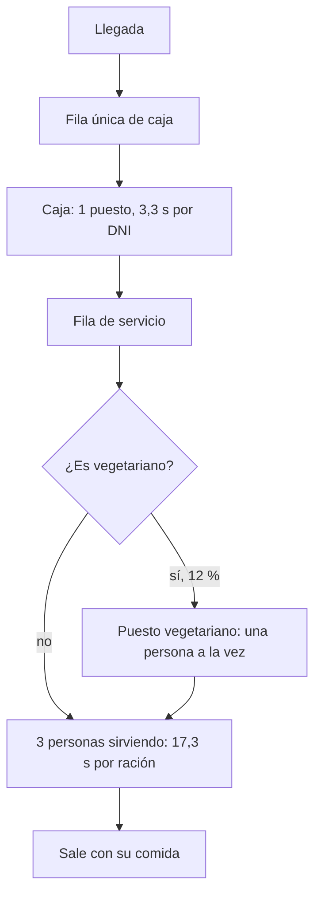

# Qué se hizo después del 10/10: servicio, menú vegetariano y tiempo por ración

[TOC]

Resumen para explicar el trabajo del 10 al 14 de octubre sobre el modelo del Comedor Universitario UNC en FlexSim. Cuenta qué cambió, por qué y qué dicen los números. Los detalles de armado están en [GUIA_MODIFICACIONES.md](GUIA_MODIFICACIONES.md) y los supuestos en [SUPUESTOS.md](../supuestos/SUPUESTOS.md).

## 1. En pocas palabras

- El grupo contó cómo funciona de verdad el mostrador: **una sola fila**, **un puesto de validación** y **3 personas sirviendo**, una de ellas a cargo de la **comida vegetariana**. El modelo se rehízo para reflejar eso.
- Con el tiempo de servicio que se había propuesto (15 a 30 s por ración), el mostrador **no alcanzaba**: la cola crecía sin parar. Eso contradice lo que el grupo sabe: **la cola se forma solo en la validación, no en el servicio**.
- Se ajustó el servicio a **15 a 20 s por ración** (mediana 17,3 s, sigma 0,09). La cola del mostrador baja mucho, pero con 3 personas todavía existe en el pico.
- La validación **no se tocó**: su tiempo (3,3 s de mediana por DNI) sale de los registros reales y es lo que reproduce la curva de validaciones por franja.
- Falta una medición en campo que decide el resto: cuánto tarda **solo servir** y cuánto se camina entre la caja y el mostrador.

## 2. Cómo funciona ahora el modelo



| Antes | Ahora | Supuesto |
|---|---|---|
| Fila de viandas y fila general | Una sola fila para todos | S13 |
| 2 personas sirviendo | 3 personas sirviendo | S22 |
| Cualquiera sirve cualquier menú | Una persona se encarga del menú vegetariano | S22 |
| Servicio de 5 s por ración | 15 a 20 s por ración (mediana 17,3 s) | S15 |
| Menú solo con o sin TACC | 12 % pide menú vegetariano (generado) | S27 |

La persona del puesto vegetariano cuenta como una de las tres. El modelo no distingue cuál es: es una simplificación y se declara en el informe.

## 3. El problema: el mostrador no alcanzaba

Todo lo que sale de la caja tiene que pasar por el mostrador. Si entra más gente por hora de la que el mostrador puede servir, la cola crece sin límite. Las cuentas son simples:

- **Caja:** valida unas 900 a 1.000 raciones por hora en el pico. Es un dato medido (hasta 168 en 10 minutos).
- **Mostrador con 21 s por ración:** 3 personas sirven como máximo 3 × 3600 / 21 ≈ **514 raciones por hora**. Es casi la mitad de lo que entra.
- **Resultado en el modelo:** una cola de **325 personas** y 27,5 minutos de espera media en el mostrador. Los datos y el grupo dicen lo contrario.

Algo no cierra. Las tres cosas que se sabían no pueden ser ciertas a la vez: *3 personas sirviendo*, *15 a 30 s por ración* y *casi sin cola en el servicio*. Hacer la validación más lenta no lo arregla: el ritmo de la caja es un dato medido, y si se lo frena el modelo deja de reproducir la curva real.

La explicación más probable es que el 15 a 30 s del referente **incluya algo más que servir** (el recorrido, la espera, mostrar la credencial). Fue una observación de una sola visita, sin cronómetro.

## 4. La decisión: 15 a 20 s por ración

Se asumió que el servicio dura entre 15 y 20 s por ración. En el modelo es una lognormal:

| Parámetro | Valor | Cómo sale |
|---|---|---|
| Mediana (Scale) | 17,3 s | √(15 × 20), la media geométrica de los extremos |
| Sigma (Shape) | 0,09 | ln(20 / 15) / (2 × 1,645), para que el 90 % caiga entre 15 y 20 s |
| Media | 17,4 s | 17,3 × e^(0,09² / 2) |

Se justifica así: la espera se percibe más larga que el reloj (17 s se pueden sentir como 25), y con 15 a 30 s el mostrador se saturaría, cosa que no se observa. **Sigue siendo un supuesto «propuesto»**, no una medición.

## 5. Qué dice la réplica con este valor

La réplica en Python (`analisis/referencia_modelo.py`) usa las mismas tablas que FlexSim. Da el orden de magnitud que tiene que dar el modelo. Pico, media de 30 réplicas:

| Escenario | Cola máx. en la caja | Espera media en el mostrador | Cola máx. en el mostrador | Uso del servicio |
|---|---|---|---|---|
| E0 base: 1 puesto, 3 sirviendo | 71 | 9,9 min | 158 | 95 % |
| E1: 2 puestos, 3 sirviendo | 70 | 9,6 min | 158 | 94 % |
| E2: 2 puestos de 12:00 a 13:30 | 72 | 11,1 min | 172 | 96 % |
| E3: QR | 72 | 9,9 min | 158 | 94 % |
| E4: 1 puesto, 4 sirviendo | 71 | 0,5 min | 27 | 71 % |
| E5: 2 puestos, 4 sirviendo | 69 | 0,6 min | 46 | 71 % |

Tres lecturas:

1. **Mejorar la caja (E1, E2, E3) no cambia nada.** El cuello de botella está en el mostrador.
2. **Una cuarta persona sirviendo (E4, E5) baja la espera de unos 10 minutos a menos de 1.** Es lo que pidió la cátedra: ver si mejorar la caja solo traslada la cola.
3. **Con 3 personas todavía hay cola en el mostrador (158)**, y los datos dicen que casi no hay. El modelo la exagera mientras el tiempo por ración sea de 17 s.

### Sensibilidad al tiempo por ración

Escenario base en el pico, con 3 personas sirviendo:

```grafico
tipo: barras
titulo: Espera media en el mostrador según la mediana por ración
unidad: min

Mediana por ración, Espera media
8 s, 0.0
10 s, 0.0
12 s, 0.2
14 s, 1.0
15 s, 2.4
17.3 s, 9.9
18 s, 12.8
21 s (valor anterior), 27.5
```

La espera es muy sensible: pasar de 15 a 18 s multiplica por 5 la espera. Con unos 12 s por ración y 3 personas, la cola del mostrador casi no existe, que es lo que el grupo observa.

## 6. Qué cambió en los archivos

| Archivo | Cambio |
|---|---|
| `supuestos/supuestos.json` | S15 con mediana 17,3 s y sigma 0,09, y la nota de por qué se ajustó |
| `supuestos/SUPUESTOS.md` | Regenerado desde el JSON |
| `flexsim/inputs.xlsx` | Regenerado: `TiemposServicio` con 17,3 y 0,09, y `ProbVegetariano` en `Escenarios` |
| `flexsim/GUIA_MODIFICACIONES.md` | Pasos para sacar la fila de viandas, agregar el menú vegetariano y el servicio con 3 personas; sección 2 rehecha con la réplica |
| `flexsim/comedor_unc_1.fsm` | Modelo de FlexSim con los cambios |
| `3d/` | Modelo 3D del comedor, versión v00 |

Para cambiar un valor hay que hacerlo en `supuestos.json` y regenerar las tablas. Si se toca solo la tabla de FlexSim, la próxima reimportación pisa el cambio.

## 7. Lo que sigue abierto

- [ ] Cronometrar solo el servir: desde que la persona llega al mostrador hasta que recibe la comida.
- [ ] Medir o estimar la caminata entre la caja y el mostrador (unos 5 m; a paso normal, de 4 a 8 s). No cambia el tamaño de las filas: desplaza las llegadas al mostrador. Sí suma al tiempo total desde la llegada hasta retirar la bandeja, y puede importar si el espacio de la fila de servicio es limitado (S23).
- [ ] Confirmar el 12 % de comida vegetariana (S27): hoy es un supuesto generado.
- [ ] Definir el espacio real de la fila de servicio (S23). Si es limitado, la fila del mostrador bloquea la caja y cambia los resultados de E1 a E3.
- [ ] Decidir con el grupo si D06 (separar dos filas) se propone igual como mejora, ya que hoy hay una sola fila.
- [ ] Correr FlexSim con 17,3 s, exportar `salidas.xlsx` y validar con `python analisis/validar_modelo.py --escenario E0_Pico`. Las salidas que hay en el repositorio son de antes del cambio.
- [ ] Correr el escenario base con 10 a 12 s como análisis de sensibilidad.
- [ ] Actualizar `capturas/AVANCE.md`, que llega hasta el 09/10.

## 8. Cómo explicarlo en dos minutos

1. El grupo describió el mostrador real y se rehízo el modelo: una fila, un puesto de validación y 3 personas sirviendo.
2. Con el tiempo de servicio de 15 a 30 s, las cuentas no cierran: el mostrador sirve 500 por hora y entran 900. El modelo mostraba una cola enorme donde en la realidad no la hay.
3. La validación se dejó como estaba, porque está medida con los registros reales. Se ajustó el servicio a 15 a 20 s, y la cola del mostrador baja de 325 a 158 personas.
4. Lo que sí queda claro: mejorar solo la caja no sirve, y una cuarta persona sirviendo baja la espera de 10 minutos a menos de 1.
5. Falta medir en campo cuánto tarda de verdad servir y cuánto se camina. Con esos dos datos se cierra el supuesto S15.
