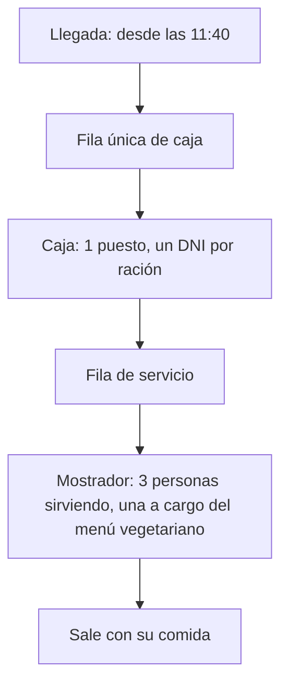

# TPI Simulación: Comedor Universitario UNC, avance al 14/10

[TOC]

**Integrantes:** Jonatan Harbertz y Juan Chavez · **Software:** FlexSim 2026 for Education, con Process Flow

Este documento resume para la cátedra el estado del trabajo desde la Entrega 1: qué cambió del planteo y por qué, de dónde salen los datos, cómo está armado el modelo, cómo lo validamos, qué muestran los primeros resultados y qué queremos consultar.

## Resumen

- **Conseguimos los registros reales del comedor:** 34.509 retiros en 32 días de servicio. Con ellos calculamos las llegadas por franja y el tiempo de validación, que en la Entrega 1 eran supuestos.
- **Cambió el alcance**, siguiendo la devolución de la cátedra. Ahora el sistema va desde la llegada a la fila hasta retirar la comida en el mostrador. Así se puede ver si mejorar la caja solo corre la cola al servicio de comida.
- **El modelo de FlexSim corre de punta a punta** en el escenario base. La cola de la caja (66 personas) y la curva de validaciones por franja coinciden con lo real.
- **Encontramos que el cuello de botella está en el mostrador, no en la caja.** Agregar un puesto de validación no mejora nada. Una cuarta persona sirviendo baja la espera en el mostrador de unos 10 minutos a menos de 1.
- **El supuesto más débil es el tiempo de servicio por ración (S15).** Los resultados dependen mucho de ese valor, y vamos a cronometrarlo.

## 1. El sistema y la pregunta

El Comedor Universitario de la UNC funciona con reserva previa online. Al mediodía, quien reservó hace la fila, valida su reserva con el DNI en el puesto de control (la caja), pasa al mostrador y retira su comida. En el pico se forma una fila de 60 a 70 personas que serpentea entre las mesas.


*Figura 1. El salón en el horario de almuerzo. A la izquierda, la fila avanza entre las mesas, guiada con cordones.*

### Pregunta de estudio

> ¿Qué combinación de puestos de validación, organización de la fila y personas en el servicio de comida reduce el tiempo total desde la llegada hasta retirar la comida en el pico, sin que mejorar la caja solo traslade la cola al mostrador?

### Alcance



**Quedan fuera:** la reserva online, la cocina (su capacidad supera la demanda, S20), el salón y el retiro para llevar. Lo que la persona hace después de retirar la comida no cambia las filas que estudiamos.

## 2. Qué cambió desde la Entrega 1

| Tema | Entrega 1 | Ahora | Por qué |
|---|---|---|---|
| Pregunta | Cuántos puestos y qué horario límite de reserva | Puestos, organización de la fila y personas sirviendo | En los datos, la hora de reserva casi no predice la hora de llegada (correlación 0,13). El horario límite sirve para planificar la cocina, no cambia la cola (D04) |
| Alcance | De la reserva online a la validación | De la llegada a la fila hasta el mostrador | Devolución de la cátedra: si se mejora la caja, la cola puede pasar al mostrador (D02) |
| Fuente de datos | Registros pendientes de acceso | Export real del sistema de reservas | Lo conseguimos: 34.509 retiros del 1/7 al 1/9 |
| Tiempo de validación | Exponencial, 12 a 18 s por persona | Lognormal, media 3,8 s por DNI | Con 12 a 18 s, un puesto no puede validar 168 reservas en 10 minutos, como se ve en los registros (S07) |
| Mostrador | Línea vegetariana y no vegetariana, sin tiempos | 3 personas, una a cargo del menú vegetariano, 15 a 20 s por ración | Relevamiento del grupo del 10/10 (S15, S22) |
| Escenarios | Horario límite, segundo puesto, QR, layout de mesas | E0 a E5: puestos, QR y personas sirviendo | Ver la sección 7 |

## 3. Datos de entrada: qué es real y qué es supuesto

Cada dato tiene registrado su origen, con las cuatro categorías que pide la cátedra. De los 23 supuestos, 9 salen de los registros, 8 del referente (un integrante del grupo que trabaja en el comedor) y 6 los generamos con apoyo de IA, con la base declarada en cada caso. El registro completo está en [SUPUESTOS.md](https://github.com/JHProyectos/tpi-simulacion-2026/blob/main/supuestos/SUPUESTOS.md).

| Variable | Cómo entra al modelo | Origen |
|---|---|---|
| Llegadas a la fila | Poisson no homogéneo: una tasa por franja de 10 minutos y por grupo | Registros |
| Cola que se forma antes de abrir | 65 personas, llegadas uniformes entre las 11:40 y las 12:00 | Generado, a partir de la cola que observa el referente |
| Demora en la apertura | Empírica: los 32 valores reales (media 1,9 min) | Registros |
| Tipo de cliente | Empírica: 14 tipos en 4 grupos | Registros |
| Raciones por persona | Empírica: 1, 2 o 3 DNI por persona | Generado |
| Tiempo de validación por DNI | Lognormal, mediana 3,3 s y media 3,8 s | Registros |
| Menú vegetariano | 12 % de las personas | Generado |
| Tiempo de servicio por ración | Lognormal, mediana 17,3 s y media 17,4 s | Referente, ajustado (sección 6) |
| Puestos de caja y personas sirviendo | 1 y 3 en el escenario base | Referente |
| Espacio de la fila de servicio | Sin límite por ahora | Pendiente (S23) |

Usamos dos perfiles de demanda: **pico** (1.543 retiros por día, desde el 10 de agosto) y **bajo** (723 por día, julio). El 18 de agosto se excluye: el puesto de validación se interrumpió 14 minutos con la fila esperando (S26).

### Cómo sacamos el tiempo de validación de los registros

No pudimos cronometrar, pero el registro guarda la hora de cada validación. En las franjas de 10 minutos con 140 validaciones o más, el puesto nunca está libre: siempre hay alguien esperando. En esas franjas, **el intervalo entre dos validaciones seguidas es el tiempo de servicio**. Tomamos los 1.959 intervalos de las 13 franjas que cumplen esa condición y ajustamos una lognormal:

$$T_{val} \sim \text{Lognormal}(\mu = 1{,}205;\ \sigma = 0{,}494) \quad \Rightarrow \quad \text{mediana} = e^{\mu} \approx 3{,}3 \text{ s}, \qquad \text{media} = e^{\mu + \sigma^2/2} \approx 3{,}8 \text{ s}$$

Es un tiempo **por DNI**: quien retira por otras personas valida cada DNI por separado, y en FlexSim suma una muestra por ración. Con un solo puesto, la caja valida unas 920 a 1.000 raciones por hora.


*Figura 2. Las dos distribuciones de servicio, cargadas en FlexSim desde la tabla `TiemposServicio`.*

Todas las tablas del modelo (llegadas, tipos, tiempos, escenarios) se generan con scripts de Python desde los registros y el archivo de supuestos, y se importan a FlexSim desde Excel. Si cambia un supuesto, se regeneran las tablas y el modelo no se toca.

## 4. El modelo en FlexSim

Está armado en **Process Flow**: cada persona es un token, y las filas son las esperas por un recurso. El reloj arranca a las 11:40 (`t = 0`), la caja abre a las 12:00 más la demora de apertura, deja de entrar gente a las 14:30 y la corrida termina a las 16:00, cuando ya se vaciaron las filas.


*Figura 3. El Process Flow completo.*

Tiene tres partes:

1. **Control del día** (columna izquierda): prepara la corrida, genera la cola previa y bloquea el puesto de caja hasta la apertura.
2. **Puesto extra** (columna del medio): abre un segundo puesto en el horario que fija el escenario. Se usa en E2.
3. **Circuito de la persona** (derecha): dos fuentes de llegadas, la cola previa y las llegadas por franja. Después se asignan el tipo, las raciones y el menú, y la persona hace la fila, valida, pasa a la fila de servicio, la atienden y sale.

Los recursos son cuatro: `PuestosValidacion` (1 o 2 puestos), `EspacioFilaServicio` (lugares entre la caja y el mostrador), `PuestoVeg` (el puesto vegetariano) y `ServicioComida` (3 o 4 personas). La persona toma un lugar en la fila de servicio **antes** de liberar la caja. Así, si la fila del mostrador se llena, la caja se bloquea, como pasaría en el comedor.

### El mostrador y el menú vegetariano


*Figura 4. El tramo del mostrador.*

Quien pide menú vegetariano toma primero el `PuestoVeg`, que atiende de a una persona, y después una de las 3 personas que sirven. Quien no lo pide toma directamente una de las 3. Con eso se representa que una de las tres se encarga del menú vegetariano y, si está libre, sirve también el otro menú. **Simplificación declarada:** el modelo no distingue cuál de las tres personas es la del puesto vegetariano.

### Un solo modelo para todos los escenarios


*Figura 5. El parámetro `Escenario` elige la fila de la tabla `Escenarios` que usa la corrida.*

Los 12 escenarios (6 configuraciones por 2 perfiles de demanda) son filas de una tabla. El modelo lee de ahí los puestos, las personas sirviendo, el factor de validación y la demanda. Cambiar de escenario es cambiar un número, y el Experimenter puede recorrerlos todos con réplicas.

## 5. Verificación y validación

Trabajamos en dos niveles:

- **Verificación:** escribimos una réplica mínima del modelo en Python, que usa las mismas tablas. Si FlexSim da otro orden de magnitud, hay algo mal armado.
- **Validación:** comparamos el escenario base contra el sistema real: la curva de validaciones por franja de los registros y la cola observada por el referente.


*Figura 6. Indicadores del día de una corrida del escenario base (E0, pico).*

| Indicador | FlexSim (una corrida) | Réplica en Python (media de 30) | Sistema real |
|---|---|---|---|
| Cola máxima en la caja | 66 | 71 | 60 a 70 personas (referente) |
| Raciones validadas en el día | 1.539 | | 1.546 (media de 11 días pico) |
| Cola máxima en el mostrador | 131 | 158 | Casi no hay cola (referente) |

El total del día y la curva por franja son de la corrida del 09/10, anterior al cambio del mostrador. Mientras la fila de servicio no tenga límite, el mostrador no cambia lo que pasa en la caja.

La curva de validaciones por franja de la corrida cae dentro del rango de los días reales en las 16 franjas:

```grafico
tipo: lineas
titulo: Raciones validadas por franja de 10 minutos, perfil pico
unidad: raciones

Franja, Real (media), Real (mínimo), Real (máximo), FlexSim
12:00, 103, 61, 139, 106
12:10, 135, 100, 168, 145
12:20, 125, 104, 161, 135
12:30, 119, 97, 144, 122
12:40, 118, 83, 148, 108
12:50, 105, 80, 121, 96
13:00, 119, 90, 138, 122
13:10, 127, 111, 146, 116
13:20, 120, 89, 145, 132
13:30, 99, 59, 132, 97
13:40, 75, 54, 104, 69
13:50, 76, 31, 104, 84
14:00, 72, 57, 98, 70
14:10, 82, 56, 100, 83
14:20, 62, 38, 115, 49
14:30, 8, 2, 46, 5
```

La caja y las llegadas quedan validadas. **El mostrador no:** el modelo forma una cola de 130 a 160 personas donde en la realidad casi no hay. Eso es lo que explica la sección siguiente.

## 6. Lo que encontramos: el mostrador no alcanzaba

Para el tiempo de servicio no tenemos registros. La única referencia era una observación de un integrante del grupo: entre **15 y 30 s por ración**, en una sola visita y sin cronómetro. Con ese valor (mediana de 21 s) y 3 personas sirviendo, la capacidad del mostrador es:

$$\text{capacidad} = \frac{c \cdot 3600}{\bar{s}} = \frac{3 \cdot 3600}{21} \approx 514 \text{ raciones por hora}$$

En la primera hora y media del pico, la caja deja pasar entre 100 y 135 raciones cada 10 minutos, es decir, de 600 a 810 por hora. El mostrador no da abasto: en la réplica se formó una cola de **325 personas** con 27,5 minutos de espera media.

Hay tres datos que no pueden ser ciertos a la vez: *3 personas sirviendo*, *15 a 30 s por ración* y *casi sin cola en el mostrador*. No tocamos la validación, porque está medida con los registros: si la hacíamos más lenta, el modelo dejaba de reproducir la curva real. La explicación más probable es que los 15 a 30 s incluyeran algo más que servir: la espera en el mostrador, el recorrido o mostrar la credencial.

**Decisión provisoria:** tomamos **15 a 20 s por ración**, con una lognormal cuyo 90 % central cae en ese rango:

$$\tilde{s} = \sqrt{15 \cdot 20} \approx 17{,}3 \text{ s} \qquad \sigma = \frac{\ln(20/15)}{2 \cdot 1{,}645} \approx 0{,}09$$

Con 17,3 s la capacidad sube a unas 620 raciones por hora, y la cola del mostrador baja de 325 a unas 158 personas. Todavía es más de lo que se observa. Así cambia la espera según el tiempo por ración, en el escenario base:

```grafico
tipo: barras
titulo: Espera media en el mostrador según la mediana por ración (E0, pico)
unidad: min

Mediana por ración; Espera media
8 s; 0
10 s; 0
12 s; 0,2
14 s; 1,0
15 s; 2,4
17,3 s; 9,9
18 s; 12,8
21 s (15 a 30 s); 27,5
```

Pasar de 15 a 18 s multiplica la espera por 5. Con unos 12 s por ración, la cola del mostrador casi desaparece, que es lo que se ve en el comedor. **S15 es el supuesto que más pesa en los resultados**, así que lo vamos a cronometrar en el comedor: desde que la persona llega al mostrador hasta que recibe la comida.

## 7. Escenarios y primeros resultados

| Escenario | Qué cambia respecto de la base |
|---|---|
| E0 | Base: 1 puesto de caja, 3 personas sirviendo |
| E1 | 2 puestos de caja todo el turno |
| E2 | 2 puestos solo de 12:00 a 13:30 |
| E3 | Validación por QR: 60 % del tiempo actual por DNI (S24) |
| E4 | 1 puesto, 4 personas sirviendo |
| E5 | 2 puestos, 4 personas sirviendo |

Cada uno se corre en los dos perfiles. Estos son los primeros resultados de la **réplica en Python** (perfil pico, media de 30 réplicas, con 17,3 s por ración). Los resultados finales van a salir del Experimenter de FlexSim.

| Escenario | Cola máx. en la caja | Espera media en el mostrador | Cola máx. en el mostrador | Uso del servicio |
|---|---|---|---|---|
| E0 base | 71 | 9,9 min | 158 | 95 % |
| E1: 2 puestos | 70 | 9,6 min | 158 | 94 % |
| E2: 2 puestos de 12:00 a 13:30 | 72 | 11,1 min | 172 | 96 % |
| E3: QR | 72 | 9,9 min | 158 | 94 % |
| E4: 4 sirviendo | 71 | 0,5 min | 27 | 71 % |
| E5: 2 puestos, 4 sirviendo | 69 | 0,6 min | 46 | 71 % |

Lo que se lee:

1. **Mejorar la caja (E1, E2 y E3) no reduce la espera.** Dan esperas parecidas a la base, de 9,6 a 11,1 minutos, porque el cuello de botella está en el mostrador. Es la situación que pidió revisar la cátedra: con el mostrador saturado, una caja más rápida no acelera el proceso.
2. **Una cuarta persona sirviendo (E4 y E5) baja la espera en el mostrador de unos 10 minutos a menos de 1.** Es la única mejora que acelera el proceso completo.
3. **La cola máxima de la caja casi no cambia en ningún escenario**, porque se forma antes de abrir: son las 65 personas que llegan entre las 11:40 y las 12:00. Lo que cambia con 2 puestos es lo rápido que se vacía. Para comparar la caja vamos a usar la espera, no la cola máxima.

Estas conclusiones valen mientras S15 esté cerca de 17 s. Si el servicio real fuera de 12 s, el mostrador dejaría de ser el cuello de botella y los escenarios de la caja volverían a importar. Por eso el análisis de sensibilidad de S15 va a ser parte del informe.

## 8. Escena 3D

Empezamos la escena 3D. Importamos a FlexSim el plano del comedor dibujado en SketchUp: el salón con las mesas largas y, al fondo, el mostrador y la cocina. Todavía es solo la geometría. Falta ubicar la caja y el mostrador sobre el plano y conectarlos al Process Flow para ver moverse a las personas.


*Figura 7. El comedor importado desde SketchUp.*

## 9. Estado del trabajo y próximos pasos

- [x] Registros procesados y supuestos declarados con su origen
- [x] Tablas de entrada generadas e importadas a FlexSim
- [x] Llegadas, cola previa y caja: armadas y validadas contra los registros
- [x] Fila de servicio y mostrador con 3 personas y puesto vegetariano: armados y probados
- [x] Réplica en Python para verificar el modelo
- [ ] Cronometrar en el comedor el tiempo de servicio por ración (S15) y estimar el espacio de la fila de servicio (S23)
- [ ] Prueba de bondad de ajuste (chi-cuadrado o Kolmogorov-Smirnov) de la lognormal de validación sobre los 1.959 intervalos
- [ ] Exportar el registro por persona: espera en cada fila y tiempo total en el sistema; chequear con la ley de Little
- [ ] Correr los 12 escenarios en el Experimenter con 30 réplicas e intervalos de confianza
- [ ] Análisis de sensibilidad de S15 (10 a 20 s), del porcentaje vegetariano (S27) y de las raciones por persona (S21)
- [ ] Completar la escena 3D
- [ ] Actualizar en el informe la pregunta, el alcance y la declaración de IA

## 10. Uso de inteligencia artificial

Esta sección amplía la declaración de la Entrega 1. Usamos **Claude** (Anthropic) para:

- escribir los scripts de Python que procesan los registros y generan las tablas de FlexSim;
- generar los datos que no tenemos: ausentismo, cancelaciones, raciones por persona, porcentaje vegetariano, cola previa y factor del QR. Cada uno figura como «Generado (IA)» en el registro de supuestos, con la base sobre la que se eligió el valor;
- escribir la réplica en Python que usamos para verificar el modelo y de la que salen los resultados preliminares de la sección 7;
- armar la guía paso a paso del Process Flow y redactar documentación.

Las decisiones de alcance, los supuestos y el ajuste del tiempo de servicio los tomamos como grupo. El modelo de FlexSim lo armamos nosotros, y los resultados finales van a salir de FlexSim.

## 11. Lo que queremos consultar

1. **Tiempo de servicio (S15):** ¿es válido ajustarlo a 15 a 20 s para que sea coherente con lo observado, mientras no lo cronometremos? ¿O conviene dejar los 15 a 30 s y presentar la contradicción como resultado?
2. **Validación parcial:** la caja y la curva por franja coinciden con lo real, pero la cola del mostrador no. ¿Alcanza con declarar la diferencia y mostrar la sensibilidad, o hace falta calibrar hasta que coincida?
3. **Bondad de ajuste:** para la lognormal de validación, ¿la cátedra prefiere chi-cuadrado, Kolmogorov-Smirnov o el ajuste con ExpertFit?
4. **Réplicas:** es una simulación terminal (un día con inicio y fin definidos, sin período de calentamiento). ¿Son suficientes 30 réplicas por escenario, con intervalos de confianza del 95 %?
5. **Dos filas por tipo de cliente:** en la Entrega 1 propusimos separar filas, pero en el comedor hay una sola fila de caja. ¿Lo mantenemos como alternativa a evaluar o lo sacamos?
6. **Escena 3D:** ¿se espera animar a las personas, o alcanza con el Process Flow y el plano del comedor?
