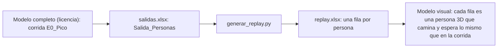

# Guía: modelo visual 3D (replay de la corrida)

[TOC]

El FlexSim sin licencia permite **35 actividades** en un Process Flow y `Comedor` tiene 41 (37 actividades y 4 recursos). Las personas 3D agregarían unas 14 más. Esta guía arma **otro modelo, solo para la animación**, que entra en el límite con mucho margen.

Las mediciones del TPI **no salen de este modelo**: salen de `Comedor`, el modelo completo, en una máquina con licencia. Este modelo solo muestra, con personas 3D, lo que ya pasó en una corrida.

## 1. La idea: reproducir la corrida

El modelo completo guarda, para cada persona, cuándo llegó, cuándo empezó y terminó de validar, cuándo entró al mostrador y cuándo salió (hoja `Salida_Personas` de `salidas.xlsx`). Con eso alcanza para **reproducir** la corrida:



El modelo visual **no decide nada**: no tiene recursos, ni tiempos al azar, ni lógica de colas. Cada persona llega cuando llegó, espera en la fila hasta su turno registrado, valida el tiempo que validó, se sirve el tiempo que se sirvió y se va. Por eso:

- La fila de caja tiene en pantalla el mismo largo que en la corrida (el máximo fue de 73 personas).
- Es la corrida real y no una imitación, y se puede decir así.
- No hay que reproducir ninguna regla del modelo: todo viene de los datos.

| Qué | Cuántas actividades |
|---|---|
| Process Flow `Replay` | **13** |
| Recursos | **0** |
| Límite de la versión sin licencia | 35 |

## 2. Qué se necesita

- [ ] `flexsim/salidas.xlsx` de la corrida que se quiere mostrar (la que está en la carpeta tiene 1.377 personas, 1 caja y 3 lugares de mostrador: es E0_Pico). Hay que confirmar que sea esa corrida.
- [ ] `flexsim/replay.xlsx`, que ya generé con `analisis/generar_replay.py` a partir de ese archivo
- [ ] `comedor_unc_2.fsm` con la escena del comedor (la Shape de Blender) puesta como en `UBICACIONES_3D.md`
- [ ] Las guías `GUIA_3D_PASO_A_PASO.md` (secciones 0.0 y 1) y `UBICACIONES_3D.md`, para ubicar los objetos

Los pasos marcados con **†** no pude verificarlos: si un nombre o un campo no coincide, mandame una captura. Usá FlexSim **en inglés**.

## 3. Preparar el archivo

1. **Copia de trabajo.** Menú **File > Save As...** y guardá como `comedor_visual.fsm` en `flexsim/`. Desde ahora trabajás en esa copia. `comedor_unc_2.fsm` y `comedor_unc_2_antes3d.fsm` no se tocan.
2. **Borrar el Process Flow `Comedor` de la copia.** En el **Toolbox**, grupo **Process Flow > General**, clic derecho sobre `Comedor` y **Delete**†. Si no aparece la opción, seleccionalo y apretá `Supr`. Es lo que baja el modelo del límite.
3. **Comprobar.** El panel **Model Limit** (abajo a la izquierda) ya no tiene que decir *Model Limit Reached*. Si lo dice, queda algo del modelo viejo: revisá que no haya otro Process Flow.
4. Las tablas globales (`Escenarios`, `TasaLlegadas_*`, etc.) se pueden dejar: no cuentan para el límite.

## 4. La escena

Se arma igual que la fase 1 de `GUIA_3D_PASO_A_PASO.md`, **solo con los objetos** (sin las tablas `Ubicaciones` ni `EstadoPuestos`/`EstadoServidores`, que acá no hacen falta):

| Qué | Sección de la guía paso a paso |
|---|---|
| Cómo crear y ubicar un objeto | 1.1 |
| `Puerta`, `Salida`, `Caja_Loc1`, `Caja_Loc2`, `Paso_Central`, `Mostrador_Loc1` a `4` y el puesto vegetariano | 1.2 |
| `Cajero1`, `Cajero2`, `Servidor1` a `4` | 1.3 |
| `Fila_Caja` y `Fila_Servicio` | 1.4 |

Las posiciones están en `UBICACIONES_3D.md`. **Un cambio de nombre:** en este modelo el puesto vegetariano se llama `Mostrador_Loc0` (con las coordenadas de `Veg_Loc`), así un solo nombre con el número de `Lugar` alcanza para todos los destinos. Para **E0** ubicá solo lo que se usa: `Cajero1` en su cubículo, `Servidor1` a `3` detrás de las cubetas, y `Cajero2` y `Servidor4` estacionados a la izquierda del edificio (X = −4). El personal es decorativo y no se mueve durante la animación.

## 5. Cargar la tabla en la Schedule Source `Llegadas`

La Schedule Source **no usa una tabla global**: tiene una tabla propia adentro, con las columnas **Time, Name y Quantity** y después una columna por cada *label*. Se carga así (confirmado en pantalla):

1. En `Llegadas`: **Arrivals** = `1377` (o `20` para la prueba) y **Labels** = `7`. **Repeat Schedule** destildado y **Offset Time** en 0.
2. Con el botón verde del Excel (arriba a la derecha de la tabla) importá `flexsim/replay.xlsx`. Para la prueba corta usá `flexsim/replay_prueba.xlsx` (20 personas).
3. El Excel **no puede tener una columna de numeración al principio**: la columna A tiene que ser directamente `Time`. Si la hubiera, todo se corre un lugar y el Time queda siendo el número de fila (síntoma: miles de personas creadas de golpe y FlexSim usando varios GB de memoria).
4. **Comprobar.** Después de importar, mirá que **Arrivals** siga en 1377 (a veces el import deja uno menos: si dice 1376, ponelo en 1377 y revisá que esté la última fila). Hacé clic sobre una celda de cada columna y verificá que el campo de abajo (*Arrival n: Time*, *Quantity*...) coincida. **Quantity** tiene que valer 1 en todas las filas.
5. Antes de correr todo, **probá con 20 personas** y guardá (Ctrl + S) después de cada actividad nueva.

Las columnas del archivo, en este orden: `Time, Name, Quantity, tIrCaja, Puesto, tValidacion, tIrMostrador, Lugar, tServicio, EsVeg`. Se generan con `analisis/generar_replay.py`:

| Comando | Qué arma |
|---|---|
| `python analisis/generar_replay.py` | La repetición fiel de la corrida (la fila de caja se vacía varias veces) |
| `python analisis/generar_replay.py --ritmo 3 --inicio 900 --cola-max 100` | **La versión que se usa para el video:** nadie llega antes de las 11:55 (instante 900); desde ahí llegan cada 3 s de media, hasta llenar la fila (100 personas; `Fila_Caja` entra unas 110). Después las llegadas bajan al ritmo de la caja (~4,2 s). **Ya no es una repetición de la corrida real**: es un escenario más exigido, y hay que decirlo en el epígrafe del video |
| `--cola-minima 3` | Solo adelanta llegadas para que siempre haya 3 esperando; no cambia el resto |

Con esa versión: **101 esperando cuando abre la caja** (12:01:54; con `--cola-max 73` serían 74, como el máximo medido), cola máxima 100, fila **nunca vacía** después de abrir, `Fila_Servicio` hasta 4 personas, última salida a las **13:38** (instante 7102), 148 vegetarianos.

Qué significa cada columna (todo en segundos desde las 11:40, que es el instante 0 del modelo):

| Columna | Significado |
|---|---|
| `tLlegada` | Cuándo aparece la persona en la puerta |
| `tIrCaja` | Cuándo sale del frente de la fila hacia la caja (2 s antes de `tInicioVal`, para llegar justo) |
| `Puesto` | A cuál `Caja_Loc` va |
| `tValidacion` | Cuánto dura la validación |
| `tIrMostrador` | Cuándo sale del frente de la fila de servicio hacia el mostrador |
| `Lugar` | A cuál `Mostrador_Loc` va (0 = el puesto vegetariano, `Mostrador_Loc0`) |
| `tServicio` | Cuánto dura el servicio |
| `EsVeg` | 1 = menú vegetariano |

## 6. El Process Flow `Replay`

1. **Crearlo.** **Toolbox > + > Process Flow > General**. Nombre: `Replay`.
2. **Biblioteca de actividades.** Clic en el **fondo vacío** de su ventana: la biblioteca de la izquierda muestra las actividades.
3. **Armar la cadena.** Arrastrá cada actividad **pegada debajo** de la anterior, así se conectan solas. Si una queda suelta, arrastrá desde el borde de la anterior hasta ella.

| # | Actividad | Grupo de la biblioteca | Nombre | Propiedades |
|---|---|---|---|---|
| 1 | Schedule Source | Token Creation | `Llegadas` | Tabla interna cargada desde el Excel (sección 5). Las 7 columnas de *labels* quedan como labels del token (ver 6.1) |
| 2 | Create Person | People Basic | `Crear persona` | *Person:* Random Person · *Destination:* `Puerta` (con el gotero) · *Copy Token Labels* tildado |
| 3 | Wait in Line | People Sub Flows | `Ir a la fila de caja` | *Person:* la label donde quedó la persona (L1) · *Waiting Line:* `Fila_Caja` |
| 4 | Delay | Basic | `Esperar turno de caja` | Tiempo: `Math.max(0, token.tIrCaja - Model.time)` |
| 5 | Walk | People Sub Flows | `Ir al puesto de caja` | *Destination:* `Model.find("Caja_Loc" + string.fromNum(token.Puesto))`† |
| 6 | Delay | Basic | `Validar` | Tiempo: `token.tValidacion` |
| 7 | Wait in Line | People Sub Flows | `Ir a la fila de servicio` | *Waiting Line:* `Fila_Servicio` |
| 8 | Delay | Basic | `Esperar turno de mostrador` | Tiempo: `Math.max(0, token.tIrMostrador - Model.time)` |
| 9 | Walk | People Sub Flows | `Ir al mostrador` | *Destination:* `Model.find("Mostrador_Loc" + string.fromNum(token.Lugar))`† |
| 9b | Walk | People Sub Flows | `Ir al mostrador` (la de arriba pasa a llamarse `Ir al previo`) | Va **antes** de la anterior, en este orden: `Ir al previo` (*Destination:* `Model.find("Previo_Loc" + string.fromNum(token.Lugar))`) y después `Ir al mostrador`. Así la persona llega al mostrador caminando en línea recta hacia el servidor y queda mirándolo† |
| 10 | Delay | Basic | `Servir` | Tiempo: `token.tServicio` |
| 11 | Walk | People Sub Flows | `Ir a la salida` | *Destination:* `Salida` |
| 12 | Remove Person | People Basic | `Quitar persona` | |
| 13 | Sink | Basic | `Sale del comedor` | |

Son 14 actividades, contra un límite de 35: sobran 21 para agregar un reloj, colores, etc.

Dónde se escriben las expresiones: doble clic sobre la actividad y, en el panel de propiedades, el campo del tiempo o del destino. Si el campo acepta solo un valor fijo, buscá junto a él un botón de código (`</>`) o una lista que diga *Expression*† para pasarlo a expresión.

Si el *Destination* no acepta una expresión†, avisame con una captura de esa ventana y lo resolvemos con un Custom Code (suma una actividad).

### 6.1 Que las columnas lleguen como *labels*

Después de armar la cadena: **Reset**, **Run** unos segundos y **Stop**. Clic sobre un token en la pestaña del Process Flow y, en el panel de propiedades, buscá la sección **Labels**†: tienen que estar `tIrCaja`, `Puesto`, `tValidacion`, `tIrMostrador`, `Lugar`, `tServicio` y `EsVeg` con los valores de la fila que le tocó.

Si no aparecen, **avisame**: hay un plan B con un Custom Code que lee la fila de la tabla por número, y suma una o dos actividades.

### 6.2 Pregunta que hay que contestar antes de seguir (L2)

En las filas hay que saber **cuándo continúa el token en `Wait in Line`**†: si cuando la persona **llega al frente** de la fila (lo esperado) o apenas **entra** a ella. La animación solo es fiel si es lo primero. Cómo saberlo: corré y mirá en la vista 3D si la `Fila_Caja` se va llenando antes de las 12:00 y las personas avanzan de a una cuando sale la de adelante. Si todas pasan directo, el token no espera en la fila: avisame y se rediseña.

## 7. Probar

1. Tabla `Replay` en `Parameters`: no hace falta ningún parámetro. Con **Repeat Random Streams** da igual: no hay nada aleatorio.
2. **Reset**, **Run** y subí el **Run Speed**.
3. Compará con la corrida real:

| Control | Qué tiene que pasar |
|---|---|
| A las 12:00 (instante 1200) | La `Fila_Caja` tiene decenas de personas. El máximo de la corrida fue **73** (`Salida_Dia.ColaCajaMax`) |
| A las 12:01:54 (instante 1314,5) | Empieza a atenderse la primera persona: es la apertura (`Apertura_s`) |
| `Fila_Servicio` | Nunca más de unas **5** personas (`ColaServicioMax` = 5) |
| Fin | Con `replay_real.xlsx` (repetición fiel): la última persona sale a las 14:40 (instante 10818). Con `--ritmo 3`: a las 13:38 (instante 7102). El comedor termina vacío |
| Vegetarianos | 148 personas van a `Mostrador_Loc0` |

4. Si la fila de servicio muestra gente amontonada fuera de la línea, es porque `Fila_Servicio` mide 2,4 m (S23): las personas de más se paran en el último punto. Para la animación se puede **alargar** la línea hacia el salón, por ejemplo hasta Y = −20, sin cambiar nada de lo demás.

## 8. Mostrar otros escenarios

Cada escenario necesita **su propia corrida** del modelo completo, en una máquina con licencia:

1. Corré el escenario en `Comedor` y exportá `salidas.xlsx` (Excel Import/Export > Export).
2. Desde la raíz del TPI, indicando las cajas y los servidores del escenario, para que el reparto sea el correcto:

```bash
python analisis/generar_replay.py --entrada flexsim/salidas_E1.xlsx --salida flexsim/replay_E1.xlsx --puestos 2 --servidores 3
```

3. Importá `replay_E1.xlsx` en la tabla `Replay` (sección 5) y, en la escena, poné a `Cajero2` en su cubículo.
4. Reset, Run y grabá.

## 9. Grabar el video

Usá la grabación de pantalla de Windows (`Win + G`) o un grabador como OBS, con la vista 3D a pantalla completa. Subí el **Run Speed** para que las 3 horas simuladas entren en el tiempo de video. Dejá guardadas dos vistas de cámara: una desde arriba, para mostrar las filas, y otra en perspectiva.

## 10. Cómo decirlo en el informe

Conviene poner un epígrafe como este:

> Animación de la corrida del escenario E0_Pico, reproducida con las llegadas y los tiempos registrados en `Salida_Personas`. La lógica de decisión es la del modelo completo en Process Flow; la animación agrega solo el recorrido físico de las personas.

Así se declara el origen de lo que se muestra, que es lo que pide la cátedra, y es verdad: los números de la animación son los de la corrida. Lo que sí es **nuevo** son las caminatas (no estaban en el modelo medido): se muestran, pero **no cambian ningún indicador**, porque no se vuelven a medir.

## 11. Problemas frecuentes

| Síntoma | Causa probable |
|---|---|
| *Model Limit Reached* sigue apareciendo | Queda un Process Flow viejo en el Toolbox |
| Todas las personas aparecen juntas, o FlexSim se cuelga y usa varios GB | Las columnas del Excel están corridas (sobra la columna de numeración) o *Quantity* no vale 1 |
| Las personas no se detienen en la fila | La actividad 3 no tiene la *Waiting Line* elegida, o el token no espera al frente (6.2) |
| Error *Invalid destination* en un Walk | El nombre del Location no coincide, o `Puesto` o `Lugar` no llegaron como label (6.1) |
| La fila de caja no llega a 73 personas | Falta cargar bien las 1.377 filas: revisá que la tabla tenga 1377 filas |
| Las personas se solapan en el puesto | Está bien: dos personas pueden coincidir un instante porque la caminata de una termina cuando empieza la otra |

## 12. Checklist

- [ ] Copia `comedor_visual.fsm` creada y `Comedor` borrado de ella
- [ ] Panel Model Limit sin el cartel
- [ ] Escena con los objetos y las dos filas
- [ ] Tabla `Replay` con 1377 filas
- [ ] Process Flow `Replay` de 14 actividades, con las expresiones cargadas
- [ ] Labels del token verificadas (6.1) y pregunta L2 contestada (6.2)
- [ ] Prueba: 101 en la fila a la apertura (73 en el replay fiel), 148 vegetarianos, salida a las 14:40 (replay fiel) o a las 13:38 (`--ritmo 3`)
- [ ] Video grabado y epígrafe puesto
