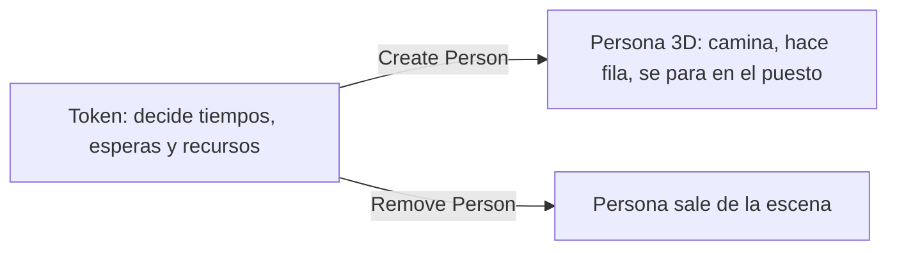
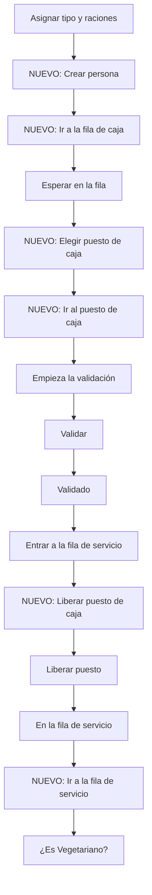

# Guía: personas en 3D con el módulo People

[TOC]

Esta guía se aplica sobre `comedor_unc_2.fsm`, la copia del modelo ya validado con `GUIA_FLEXSIM.md` y `GUIA_MODIFICACIONES.md`. Hace que cada cliente sea una **persona 3D** que entra por la puerta, hace fila, camina hasta el puesto, la atienden y se va, sin cambiar la lógica que ya está validada. El profe pidió trabajar con personas: esta es la forma de hacerlo sin perder los resultados.

Se arma por fases y **cada fase termina con una prueba**. No pases a la siguiente si la prueba no da.

## 1. Qué se busca y cómo

### La idea: el token piensa, la persona camina

Hoy cada persona es un token y los puestos son recursos numéricos. Todo eso **queda como está**: es lo que ya se validó contra la réplica en Python y contra los registros. Lo nuevo es que cada token tiene una persona 3D asociada, que lo sigue por la escena.



### Qué cambia y qué no

| Se mantiene igual | Cambia |
|---|---|
| Los 4 recursos (`PuestosValidacion`, `EspacioFilaServicio`, `PuestoVeg`, `ServicioComida`) con sus *Count* de la tabla `Escenarios` | Aparecen personas, filas físicas (Waiting Line) y personal en el 3D |
| Los tiempos de validación y de servicio (S07 y S15) | Aparece la **caminata** entre estaciones (supuesto nuevo, sección 12) |
| Las tablas de salida y las marcas `tLlegada`, `tInicioVal`, etc. | La fila de servicio tiene un largo físico, que fija su capacidad (S23) |
| Los 12 escenarios y el Experimenter | El personal se ubica según el escenario (sección 8) |

### Qué caminatas le cuestan capacidad al sistema

Esto es lo más importante para no distorsionar los resultados:

| Caminata | ¿Retiene un recurso? | Efecto |
|---|---|---|
| Puerta a la fila de caja | No | Ninguno |
| Frente de la fila al puesto de caja | **Sí, el puesto** | Resta capacidad a la caja |
| Caja a la fila de servicio | No (el puesto ya se liberó) | Solo suma espera |
| Frente de la fila de servicio al mostrador | **Sí, el servidor** | Resta capacidad al servicio |
| Mostrador a la salida | No | Ninguno (`tSalida` se registra antes de caminar) |

Por eso el **frente de cada fila tiene que quedar pegado al puesto** (menos de 1,5 m). Con 4 m de caminata, un servidor que atiende en 17 s pasaría a necesitar 21 s por persona y el mostrador se saturaría por una razón que no existe en el comedor.

## 2. Qué fuentes usé y qué hay que confirmar

La ayuda online que pasaste (`help.autodesk.com/view/FLEXSIMIN/2026`) carga **solo la página de bienvenida**. Todas las demás dan *Page Not Found*, también al entrar desde el buscador (probado el 03/11). Lo que sí sirvió es lo que trae tu instalación:

- Los **textos de la interfaz** de FlexSim 2026 (`program/translations/en-US.csv`): nombres de objetos, actividades, campos y tooltips del módulo People.
- La **referencia de FlexScript** (`help/FlexScriptAPIReference`): `Model.find`, `Object.location`, `Table`, `string`.

**Confirmado en tu instalación:**

| Qué | Dónde está |
|---|---|
| Objetos 3D: Location, Staff, Waiting Line, Prop (y Transport, Equipment, MultiLocation, Elevator Bank) | Biblioteca de la izquierda, grupo **People** |
| Actividades de Process Flow: Create Person, Remove Person, Walk, Wait in Line, Acquire/Release Staff y Location, Staff Resource, Location Resource | Ventana de actividades del Process Flow, grupos **People Basic**, **People Sub Flows**, **People Resources** y **People Activity Sets** |
| El set **Wait in Line then Process** (Acquire Location, Acquire Staff, Walk, Process, Release Staff, Release Location, Wait In Line, y los recursos Location, Staff y Waiting Line) | **People Activity Sets** |
| Waiting Line: campos *Points*, *Gap Size*, *Single Entry Point*, *Width*, *Draw Floor*, *Draw Stanchions*; eventos *OnEntry*, *OnExit*, *OnPersonReady* | Panel de propiedades del objeto |
| Create Person: campos *Person*, *Destination*, *Label Set*, *Copy Token Labels*, *Person Flow* | Propiedades de la actividad |
| Staff trae configuraciones prearmadas, entre ellas **Clerk**. Location trae **Registration**, **Kiosk**, **Floor Spot** | Propiedades del objeto |
| FlexScript: `Model.find("Nombre")`, `obj.location = Vec3(x, y, z)`, `obj.rotation`, `obj.size` | Referencia de FlexScript |

**Marcado con † = no pude verificarlo.** Lo que está marcado hay que confirmarlo en pantalla. Si un campo se llama distinto o no existe, mandame una captura de esa ventana y lo ajusto. La fase 2 (el laboratorio) está pensada justamente para resolver las dudas más importantes antes de tocar el modelo.

Recordá usar FlexSim **en inglés**: la traducción al español es parcial.

## 3. Decisiones previas

Dependen del grupo, no de FlexSim. Dejalas escritas antes de empezar.

| # | Decisión | Recomendación |
|---|---|---|
| P1 | ¿La caminata se suma al tiempo de servicio, o ya está incluida en los 15 a 20 s (S15)? | Que **ya esté incluida** en el mostrador (frente de la fila pegado al puesto) y que se sume solo donde no retiene recursos |
| P2 | ¿Qué hace la persona después de servirse? | **Camina a la salida y desaparece.** Comer no entra al modelo: no hay tiempo de comida y no afecta la pregunta del TPI |
| P3 | ¿Dónde están físicamente la puerta, la caja y el puesto vegetariano? | Preguntarle al referente. Las posiciones de la sección 4.4 son **provisorias** |
| P4 | ¿Qué velocidad de caminata se usa? | 1,2 m/s (valor típico de peatones). Declararlo como supuesto generado con apoyo de IA, con su base (sección 12) |

## 4. Fase 0: preparación

### 4.1 El archivo y la corrida de referencia

1. Ya tenés `comedor_unc_2.fsm`. Trabajá solo en ese.
2. **Corregí el defecto del menú vegetariano** antes de seguir (ver `AYUDA_IA.md`, sección 5: el orden de `PuestoVeg` y `Esperar Servidor`), porque si no la corrida de referencia ya sale mal.
3. Corré `E0_Pico` y **exportá `salidas.xlsx` con otro nombre**, por ejemplo `salidas_sin3d_E0_Pico.xlsx`. Es la referencia contra la que vas a comparar al final de cada fase.
4. Anotá la semilla (*Random Seed*) que usaste. Todas las pruebas se hacen con la misma.

### 4.2 Escala de la escena

1. Seleccioná el edificio importado y mirá su posición y tamaño en el panel de propiedades.
2. Tiene que medir cerca de **16,5 m de ancho (X), 95,5 m de largo (Y) y 6,8 m de alto (Z)**, que es lo que tiene el dibujo (`3d/comedor-v00.dae`, en metros, Z hacia arriba).
3. Si da otra cosa, la importación escaló mal y hay que corregirla antes de poner objetos.
4. Poné un objeto cualquiera en X = 8 e Y = 87. Tiene que caer sobre la mesada larga del fondo.

### 4.3 Qué hay en el dibujo

Medido en el archivo `.dae`:

| Zona | X (m) | Y (m) | Qué es |
|---|---|---|---|
| Sector sin muebles | 0 a 16 | 0 a 58 | Vacío: cabe la fila de caja |
| Salón con mesas y sillas | 1 a 15 | 60,5 a 81,7 | Comedor |
| Dos bloques de 2,75 m de alto | 3,55 a 6,35 y 9,6 a 12,4 | 82,5 a 85 | Sin identificar. Preguntar al referente |
| Mesada larga de 0,9 m | 0 a 15,2 | 86,6 a 87,9 | **El mostrador** (probable) |
| Dos mesadas de 0,9 m | 3 a 4,8 y 8 a 9,8 | 91 a 95 | Cocina |

El pasillo libre entre los dos bloques va de X = 6,35 a X = 9,6 (3,25 m). **La caja, la puerta y el puesto vegetariano no están en el dibujo.**

### 4.4 Posiciones provisorias

Cada fila de la tabla es un objeto. Los nombres son los que usa el código, **no los cambies**.

| Objeto | Tipo | X | Y | Z | Para qué |
|---|---|---|---|---|---|
| `Puerta` | Location | 8 | 1 | 0 | Donde se crea cada persona (supuesto: entran por el extremo sur) |
| `Salida` | Location | 11 | 1 | 0 | Donde desaparece |
| `Caja_Loc1` | Location | 7,2 | 55,6 | 0 | Donde se para el cliente en el puesto 1 |
| `Caja_Loc2` | Location | 8,8 | 55,6 | 0 | Idem, puesto 2 |
| `Cajero1` | Staff | 7,2 | 56,8 | 0 | Detrás del puesto 1 |
| `Cajero2` | Staff | 8,8 | 56,8 | 0 | Detrás del puesto 2 |
| `Mostrador_Loc1` a `Mostrador_Loc4` | Location | 6,7 / 7,6 / 8,5 / 9,4 | 85,9 | 0 | Donde se para el cliente en cada lugar del mostrador |
| `Veg_Loc` | Location | 10,4 | 85,9 | 0 | Donde se para quien pide menú vegetariano |
| `Servidor1` a `Servidor4` | Staff | 6,7 / 7,6 / 8,5 / 9,4 | 88,6 | 0 | Detrás de la mesada |
| `Fila_Caja` | Waiting Line | ver 5.3 | | 0 | Fila de la caja |
| `Fila_Servicio` | Waiting Line | ver 5.3 | | 0 | Fila del mostrador |

### 4.5 La tabla `Ubicaciones`

Es una Global Table que usa el código de la fase 4. Una fila por persona del personal, con su puesto y su lugar de espera (fuera del edificio) cuando no se usa en el escenario:

| Objeto | Rol | Numero | X | Y | Z | EstX | EstY |
|---|---|---|---|---|---|---|---|
| Cajero1 | Cajero | 1 | 7,2 | 56,8 | 0 | -4 | 56,8 |
| Cajero2 | Cajero | 2 | 8,8 | 56,8 | 0 | -4 | 56,8 |
| Servidor1 | Servidor | 1 | 6,7 | 88,6 | 0 | -4 | 88,6 |
| Servidor2 | Servidor | 2 | 7,6 | 88,6 | 0 | -4 | 88,6 |
| Servidor3 | Servidor | 3 | 8,5 | 88,6 | 0 | -4 | 88,6 |
| Servidor4 | Servidor | 4 | 9,4 | 88,6 | 0 | -4 | 88,6 |

Por ahora cargala a mano en FlexSim (*Toolbox > + > Global Table*†) y marcala como **provisoria**. Después se pasa a `generar_inputs_flexsim.py` y a `supuestos.json`, porque la regla del proyecto es que los valores no se editan a mano en las tablas.

También creá dos tablas chicas de estado, que se usan en la fase 3 (una fila por puesto, una columna `Ocupado`):

| Tabla | Filas | Columna |
|---|---|---|
| `EstadoPuestos` | 2 | `Ocupado` (0 o 1) |
| `EstadoServidores` | 4 | `Ocupado` (0 o 1) |

## 5. Fase 1: los objetos en la escena

Todavía no se toca el Process Flow. Solo se arma la escena.

### 5.1 Vista de arriba

Poné la vista 3D en proyección ortogonal desde arriba† (el botón está en la barra de la vista). Es mucho más fácil ubicar objetos así.

### 5.2 Crear los objetos

1. En la biblioteca de la izquierda abrí el grupo **People**.
2. Arrastrá a la escena, en cualquier lugar, uno por cada fila de la tabla 4.4: **Location**, **Staff** y **Waiting Line**.
3. Por cada uno, nombralo y poné su posición X, Y, Z en el panel de propiedades†, con los valores de la tabla.
4. Configuración sugerida: a los dos `Cajero` ponerles la configuración **Clerk**† y a `Caja_Loc1` y `Caja_Loc2` la forma **Registration**†. A los `Mostrador_Loc` y a `Veg_Loc`, **Floor Spot**†. A los `Servidor`, la configuración que más se parezca a un cocinero o empleado†.
5. Rotación: los `Cajero` y `Servidor` tienen que mirar hacia donde está el cliente. Se prueba con la rotación Z hasta que quede bien†.

### 5.3 Las filas (Waiting Line)

Una Waiting Line es una línea de puntos por donde se acomodan las personas. Los campos confirmados son **Points** (cantidad de puntos), **Gap Size** (espacio entre personas) y **Single Entry Point** (todos entran por el inicio de la línea y caminan hasta su lugar).

| Fila | Puntos (X, Y), del frente al fondo† | Gap Size | Single Entry Point |
|---|---|---|---|
| `Fila_Caja` | (8, 54,8), (8, 16), (10,5, 16), (10,5, 54) | 0,6 m | Tildado |
| `Fila_Servicio` | (8,05, 85), (8,05, 62) | 0,6 m | Tildado |

Si el primer punto es el frente o el fondo† se confirma en el laboratorio (sección 6). El **frente** tiene que quedar pegado a los puestos: a menos de 1,5 m de `Caja_Loc1`/`Caja_Loc2` y de los `Mostrador_Loc`.

**Capacidad aproximada:** largo de la línea dividido por el gap. `Fila_Caja` mide unos 79 m, que da unas 130 personas (el máximo del pico es 66). `Fila_Servicio` mide 23 m, que da **unas 38 personas**. Con 17,3 s por ración, el mostrador llegó a 131 personas en cola en la corrida del 14/10, así que esta fila física **no alcanza y bloqueará la caja**. Es justo lo que pasa en la realidad y define el supuesto S23 (sección 9).

### 5.4 Grupos

En el Toolbox hay una categoría **Groups** con *Location Group* y *Staff Group*†. Creá:

| Grupo | Miembros | Para qué |
|---|---|---|
| `Cajeros` | `Cajero1`, `Cajero2` | Solo si después pasás al personal real |
| `Servidores` | `Servidor1` a `Servidor4` | Idem |

En esta versión de la guía el personal es **decorativo**, es decir, no se adquiere como recurso con Acquire Staff: la lógica sigue en los recursos numéricos que ya validaste. Los grupos quedan armados por si hay tiempo de pasar al personal real, que sería una fase aparte y con su propia validación.

**Prueba de la fase 1:** se ve la escena con los puestos, el personal y las dos filas dibujadas, sin personas todavía. Guardá el modelo.

## 6. Fase 2: laboratorio

Antes de tocar `Comedor`, armá un Process Flow aparte de 10 minutos para **ver cómo se comporta FlexSim**. Hay cuatro cosas que no pude confirmar y de las que depende todo lo demás.

### 6.1 Armarlo

1. *Toolbox > + > Process Flow > General*, nombre `Prueba_People`.
2. Arrastrá un **Schedule Source** con una fila en la tabla: *Arrival Time* 0, *Quantity* 20.
3. A continuación, **Create Person** (grupo People Basic): *Person* = Random Person, *Destination* = `Puerta`, *Copy Token Labels* tildado.
4. Arrastrá del grupo **People Activity Sets** el set **Wait in Line then Process**. Viene con sus bloques y los tres recursos: Location, Staff y Waiting Line.
5. En cada recurso elegí el objeto con el gotero, haciendo clic en el objeto 3D: *Waiting Line* = `Fila_Caja`, *Location* = `Caja_Loc1`, *Staff* = `Cajero1`†.
6. En *Process* poné un tiempo fijo de 5 s.
7. Cerrá con **Remove Person** y un **Sink**.
8. Si dos actividades quedaron sueltas, conectalas arrastrando desde el borde de la primera hasta la segunda (como en `GUIA_FLEXSIM.md`, sección 7).

### 6.2 Qué mirar (y anotar)

Corré con **Reset** y **Run**, y observá con la vista 3D. Hay que contestar cuatro preguntas:

| # | Pregunta | Qué hacer para saberlo | Por qué importa |
|---|---|---|---|
| L1 | ¿En qué *label* del token queda guardada la persona creada? | En la corrida, hacé clic en un token del Process Flow y mirá sus labels | Los campos *Person* de Walk y Wait in Line lo necesitan |
| L2 | ¿La persona **sigue dentro de la fila** hasta que se va caminando, o sale de la fila en cuanto llega al frente? | Con el puesto ocupado 5 s por persona, ¿la fila física muestra las 19 personas esperando? | Define si la fila física muestra la cola de verdad (sección 7.2) |
| L3 | ¿El primer punto de la Waiting Line es el frente o el fondo? | Mirar en qué extremo se para la primera persona | Para dibujar bien `Fila_Caja` y `Fila_Servicio` |
| L4 | ¿Cuál es la velocidad de caminata de la persona y dónde se cambia? | Mirar las propiedades del objeto Person (*Person Visuals* no, buscá una pestaña de viaje†) | Para fijar 1,2 m/s |

**Si L2 da "sale de la fila al llegar al frente":** la fila física se vacía y la cola real queda en el `Acquire`. En ese caso hay que cambiar el diseño de la sección 7.2 y avisarme, porque la persona tendría que esperar de pie junto al puesto en vez de en la fila.

Cuando tengas las cuatro respuestas, **borrá `Prueba_People`** o dejalo, no estorba. Anotá las respuestas en la sección 13 de este documento.

## 7. Fase 3: personas en el Process Flow del comedor

Abrí `Comedor`. Los nombres de las actividades son los del modelo actual (captura del 14/10). Cada bloque se inserta **entre dos actividades existentes**: arrastralo justo debajo de la anterior para que se conecten solos.



### 7.1 La persona entra

| Orden | Actividad | Nombre | Propiedades |
|---|---|---|---|
| 1 | Create Person | `Crear persona` | *Person:* Random Person · *Destination:* `Puerta` · *Copy Token Labels:* tildado. Va **justo después de `Asignar tipo y raciones`**, para que la persona aparezca en el momento en que llega (la cola previa llega entre 11:40 y 12:00) |

Anotá en qué label queda la persona (pregunta L1). En el resto de la guía la llamo `token.persona`. Si es otra, reemplazala.

### 7.2 La caja

| Orden | Actividad | Nombre | Propiedades |
|---|---|---|---|
| 2 | Wait in Line | `Ir a la fila de caja` | *Person:* `token.persona` · *Waiting Line:* `Fila_Caja`. Va **antes** de `Esperar en la fila` |
| 3 | Custom Code | `Elegir puesto de caja` | Código de abajo. Va **después** de `Esperar en la fila` |
| 4 | Walk | `Ir al puesto de caja` | *Person:* `token.persona` · *Destination:* `Model.find("Caja_Loc" + string.fromNum(token.numPuesto))`† |

`Esperar en la fila` (el Acquire de `PuestosValidacion`) **sigue exactamente como está**. La persona espera de pie en la fila física y recién cuando le toca el puesto camina.

**Elegir puesto de caja.** Guarda en el token el número del puesto libre, solo para saber a cuál `Caja_Loc` mandar a la persona. No cambia ningún tiempo:

```c
/** Elige el puesto de caja libre de menor número (solo para el 3D) */
Table ep = Table("EstadoPuestos");
int n = 1;
for (int r = 1; r <= ep.numRows; r++) {
	if (ep[r]["Ocupado"] == 0) {
		n = r;
		break;
	}
}
ep[n]["Ocupado"] = 1;
token.numPuesto = n;
```

Y **justo antes de `Liberar puesto`** (que sigue igual), un Custom Code `Liberar puesto de caja`:

```c
Table("EstadoPuestos")[token.numPuesto]["Ocupado"] = 0;
```

Para que las tablas de estado arranquen bien cada día, agregá al final del código de `Preparar el día` el bloque de la sección 8.1.

### 7.3 La fila de servicio y el mostrador

| Orden | Actividad | Nombre | Propiedades |
|---|---|---|---|
| 5 | Wait in Line | `Ir a la fila de servicio` | *Person:* `token.persona` · *Waiting Line:* `Fila_Servicio`. Va **después de `En la fila de servicio`** y antes de `¿Es Vegetariano?` |
| 6 | Custom Code | `Elegir lugar del mostrador` | Código de abajo. Va **después de `Esperar Servidor`** |
| 7 | Walk | `Ir al mostrador` | *Person:* `token.persona` · *Destination:* código de abajo. Va **después de `Liberar lugar en la fila`** y antes de `Empieza el servicio` |

**Elegir lugar del mostrador:**

```c
/** Elige el lugar libre de menor número del mostrador (solo para el 3D) */
Table es = Table("EstadoServidores");
int n = 1;
for (int r = 1; r <= es.numRows; r++) {
	if (es[r]["Ocupado"] == 0) {
		n = r;
		break;
	}
}
es[n]["Ocupado"] = 1;
token.numServidor = n;
```

**Destination del Walk `Ir al mostrador`†** (los vegetarianos van al puesto vegetariano; si el campo no acepta un operador condicional, resolvelo en el Custom Code anterior y guardá el destino en una label, por ejemplo `token.destino`):

```c
token.esVeg ? Model.find("Veg_Loc") : Model.find("Mostrador_Loc" + string.fromNum(token.numServidor))
```

Si en tu modelo el label del menú vegetariano se llama distinto de `esVeg`, usá el que corresponda.

Un Custom Code `Liberar lugar del mostrador`, **antes de `Liberar servidor`**:

```c
Table("EstadoServidores")[token.numServidor]["Ocupado"] = 0;
```

**Simplificación declarada.** El modelo no distingue cuál de las tres personas es la del puesto vegetariano (ya estaba declarado en `GUIA_MODIFICACIONES.md`). En el 3D, quien pide menú vegetariano va a `Veg_Loc`, y los demás a su `Mostrador_Loc`. Es solo visual.

### 7.4 La salida

| Orden | Actividad | Nombre | Propiedades |
|---|---|---|---|
| 8 | Walk | `Ir a la salida` | *Person:* `token.persona` · *Destination:* `Salida`. Va **después de `Registrar y salir`** |
| 9 | Remove Person | `Quitar persona` | *Person:* `token.persona`. Va después del Walk y antes del Sink |

`Registrar y salir` **no se mueve de lugar**: así `tSalida` se sigue marcando al terminar el servicio, y la caminata final no cambia ningún indicador.

### 7.5 Prueba de la fase 3

1. Con `Escenario = 1` (E0_Pico), **Reset**, **Run** hasta las 16:00 y exportá las salidas.
2. Compará con `salidas_sin3d_E0_Pico.xlsx`:

| Indicador | Qué tiene que pasar |
|---|---|
| Personas del día | Igual |
| Raciones por franja | Igual |
| Tiempo de validación | Igual |
| Espera en la fila de caja | Casi igual (suma la caminata hasta el puesto) |
| Espera en la fila de servicio | **Más alta**: suma la caminata por el pasillo (unos 25 s) y el efecto de la capacidad (sección 9) |
| Tiempo de servicio | Igual |

3. Corré `python analisis/validar_modelo.py --escenario E0_Pico`. Tiene que seguir pasando los 7 chequeos internos.
4. Mirá la escena: la fila de caja tiene que mostrar unas 60 personas en la apertura, y no tiene que haber gente amontonada en un punto.

Si el tiempo de validación o las raciones por franja cambian, **algo se rompió**: no sigas.

## 8. Fase 4: el personal según el escenario

Con un solo modelo, el 3D se ajusta al escenario activo al hacer Reset. Tres piezas.

### 8.1 Ubicar al personal en `Preparar el día`

Agregá este bloque **al final** del Custom Code de `Preparar el día`. Usa `Model.find` y `obj.location`, confirmados en la referencia de FlexScript. Pone al personal activo en su puesto y deja el resto estacionado fuera del edificio. También inicializa las tablas de estado:

```c
/** Ubica al personal según el escenario y deja listas las tablas de estado del 3D */
Table esc = Table("Escenarios");
int e = Model.parameters.Escenario;
int cajasAbiertas = esc[e]["PuestosBase"];       // el cajero extra de E2 aparece en su horario (8.2)
int servidores = esc[e]["Servidores"];

Table ub = Table("Ubicaciones");
for (int r = 1; r <= ub.numRows; r++) {
	Object o = Model.find(ub[r]["Objeto"]);
	int activo = 0;
	if (ub[r]["Rol"] == "Cajero")
		activo = ub[r]["Numero"] <= cajasAbiertas;
	else
		activo = ub[r]["Numero"] <= servidores;
	if (activo)
		o.location = Vec3(ub[r]["X"], ub[r]["Y"], ub[r]["Z"]);
	else
		o.location = Vec3(ub[r]["EstX"], ub[r]["EstY"], ub[r]["Z"]);
}

Table ep = Table("EstadoPuestos");
for (int r = 1; r <= ep.numRows; r++)
	ep[r]["Ocupado"] = r > cajasAbiertas ? 1 : 0;   // un puesto no abierto cuenta como ocupado

Table es = Table("EstadoServidores");
for (int r = 1; r <= es.numRows; r++)
	es[r]["Ocupado"] = r > servidores ? 1 : 0;
```

### 8.2 El segundo cajero de E2 (12:00 a 13:30)

En la columna del puesto extra (`GUIA_FLEXSIM.md`, sección 8, columna 2) ya existen `Abrir puesto extra` y `Cerrar puesto extra`. Agregá:

| Después de | Actividad | Nombre | Código |
|---|---|---|---|
| `Abrir puesto extra` | Custom Code | `Aparece cajero 2` | Primer código de abajo |
| `Cerrar puesto extra` | Custom Code | `Se va cajero 2` | Segundo código de abajo |

```c
/** E2: el cajero 2 ocupa su puesto y el puesto 2 queda disponible */
Table ub = Table("Ubicaciones");
for (int r = 1; r <= ub.numRows; r++) {
	if (ub[r]["Objeto"] == "Cajero2")
		Model.find("Cajero2").location = Vec3(ub[r]["X"], ub[r]["Y"], ub[r]["Z"]);
}
Table("EstadoPuestos")[2]["Ocupado"] = 0;
```

```c
/** E2: el cajero 2 se retira (después de atender a quienes ya estaban en la fila) y el puesto 2 se cierra */
Table ub = Table("Ubicaciones");
for (int r = 1; r <= ub.numRows; r++) {
	if (ub[r]["Objeto"] == "Cajero2")
		Model.find("Cajero2").location = Vec3(ub[r]["EstX"], ub[r]["EstY"], ub[r]["Z"]);
}
Table("EstadoPuestos")[2]["Ocupado"] = 1;
```

El `Cerrar puesto extra` espera su turno detrás de las personas que ya estaban en la fila, así que el cajero se va cuando termina de atenderlas, como en el modelo.

### 8.3 Prueba de la fase 4

| Escenario | Qué tiene que verse al hacer Reset y Run |
|---|---|
| 1 (E0_Pico) | 1 cajero y 3 servidores. El `Cajero2` y el `Servidor4` fuera del edificio, a la izquierda |
| E1 (2 puestos) | 2 cajeros desde el principio |
| E2 (puesto extra) | 1 cajero. A las 12:00 aparece el 2.º y a las 13:30 se va |
| E3 (QR) | Igual que E0: el QR no agrega nada físico |
| E4 | 1 cajero y 4 servidores |
| E5 | 2 cajeros y 4 servidores |

Pasá de uno a otro cambiando solo el parámetro `Escenario` y haciendo **Reset**. Después de volver a E0 no tiene que quedar nadie de más: el bloque 8.1 reposiciona a todos.

## 9. Fase 5: la fila de servicio física y S23

Hoy `CapacidadFilaServicio` vale 999 (sin límite). Con la fila dibujada ya hay un valor justificado.

1. Calculá la capacidad: largo de `Fila_Servicio` dividido por *Gap Size*. Con 23 m y 0,6 m son **38**.
2. Ponelo en la columna `CapacidadFilaServicio` de la tabla `Escenarios`, o mejor aún en `generar_inputs_flexsim.py` y reimportá, para respetar la regla de que los valores salen de `supuestos.json`.
3. Corré E0_Pico y mirá: si la fila de servicio se llena, quien terminó de validar **se queda en el puesto de caja y bloquea la caja**. Es la dinámica que pidió la cátedra.
4. Mirá cuánto sube la espera en la caja y comparala con la corrida sin límite.

Este cambio **sí modifica los resultados**, y es un cambio real: hay un largo físico que antes no se consideraba. Hay que presentarlo como la resolución de S23 y no mezclarlo con el efecto de las caminatas.

## 10. Fase 6: presentación y rendimiento

- **Colores:** pintar a las personas según su menú o su tipo de cliente. Hay una actividad **Change Visual**† en Process Flow. Las propiedades visuales de la persona están en *Person Visuals* (*Shirt*, *Pants*, etc.). Probá con la camisa.
- **Cámara:** dejá guardada una vista desde arriba y otra en perspectiva para las capturas de la entrega.
- **Rendimiento:** medí cuánto tarda una réplica de E0_Pico con personas. Si el Experimenter (12 escenarios con réplicas) se vuelve demasiado lento, agregá un parámetro `ConPersonas` (0 o 1) y un Decide antes de `Crear persona` que salte todos los bloques nuevos cuando vale 0. Las corridas del informe se hacen sin personas y la animación se muestra aparte. Esto **solo es válido si la fase 3 demostró que las caminatas no cambian los indicadores**, o si los resultados del informe se declaran con las caminatas incluidas.
- **Reloj en pantalla:** un cuadro con la hora simulada y el tamaño de las dos filas hace la animación mucho más clara.

## 11. Validación final

| Control | Resultado esperado |
|---|---|
| Verificación interna (`validar_modelo.py`) | 7 de 7 |
| Contra la realidad | Cola en la caja entre 55 y 75, espera de la cola previa entre 10 y 15 minutos |
| Contra la réplica | Las diferencias se explican por las caminatas y por S23, y están escritas |
| 12 escenarios en el Experimenter | Corren sin error y con tiempos razonables |

Anotá en `AYUDA_IA.md` y en `EXPLICACION.md` que las caminatas y la fila física se agregaron después de la validación de la lógica, y qué indicadores cambiaron y por qué.

## 12. Supuestos nuevos

Propongo estos números (no existen en `supuestos.json`, que llega hasta S27). Cada uno con su origen, como pide la cátedra:

| # | Supuesto | Valor | Origen | Estado |
|---|---|---|---|---|
| S28 | Velocidad de caminata de las personas | 1,2 m/s | Generado con apoyo de IA: valor típico de peatones adultos, 1,2 a 1,4 m/s | Propuesto |
| S29 | Capacidad de la fila de servicio | Largo físico dividido por 0,6 m (unas 38 personas) | Derivado del layout del dibujo | Propuesto. Resuelve S23 |
| S30 | Ubicación de la puerta, la caja y el puesto vegetariano | Tabla 4.4 | Referente (a confirmar) | **Pendiente** |
| S31 | La caminata dentro del mostrador ya está incluida en S15 | Sí (frente de la fila a menos de 1,5 m) | Decisión del grupo | Propuesto |

## 13. Respuestas del laboratorio

Completalo cuando hagas la fase 2:

| # | Pregunta | Respuesta |
|---|---|---|
| L1 | Label donde queda la persona creada | |
| L2 | ¿La persona sigue en la fila mientras espera el recurso? | |
| L3 | ¿El primer punto de la Waiting Line es el frente o el fondo? | |
| L4 | Velocidad de caminata y dónde se cambia | |

## 14. Problemas frecuentes

| Síntoma | Causa probable |
|---|---|
| Las personas se amontonan en un punto | Falta el **Wait in Line**, o la Waiting Line tiene *Single Entry Point* mal puesto |
| La fila física se vacía y la cola queda "invisible" | La respuesta a L2 es que sale de la fila al llegar al frente: hay que rediseñar la sección 7.2 |
| Error *Invalid destination* en el Walk | El nombre del Location no coincide con el de la tabla 4.4, o la concatenación del nombre falló (probá `string.fromNum`†) |
| El tiempo de validación o el de servicio cambiaron | Se movió `Registrar y salir`, o una caminata quedó dentro de un Delay |
| El mostrador se satura sin motivo | El frente de la fila está lejos de los `Mostrador_Loc`: la caminata retiene al servidor |
| Después de cambiar de escenario queda personal de más | No se corrió el bloque 8.1 al hacer Reset: está en `Preparar el día` |
| El cajero 2 de E2 no se va a las 13:30 | `Cerrar puesto extra` espera su turno detrás de la fila: si la fila no se vació, todavía no cierra |
| *Undefined variable* en el código | Faltan las cuatro líneas iniciales del editor de código (`GUIA_FLEXSIM.md`, sección 7) |

## 15. Checklist

- [ ] Fase 0: baseline guardado, escala verificada, posiciones confirmadas con el referente
- [ ] Fase 1: objetos y filas en la escena, grupos creados
- [ ] Fase 2: laboratorio hecho y sección 13 completa
- [ ] Fase 3: personas en el flujo, prueba contra el baseline
- [ ] Fase 4: personal por escenario, prueba de los seis escenarios
- [ ] Fase 5: S23 resuelto con la capacidad física
- [ ] Fase 6: colores, cámara, rendimiento medido
- [ ] Supuestos S28 a S31 cargados en `supuestos.json`
- [ ] `EXPLICACION.md` y `AYUDA_IA.md` actualizados
